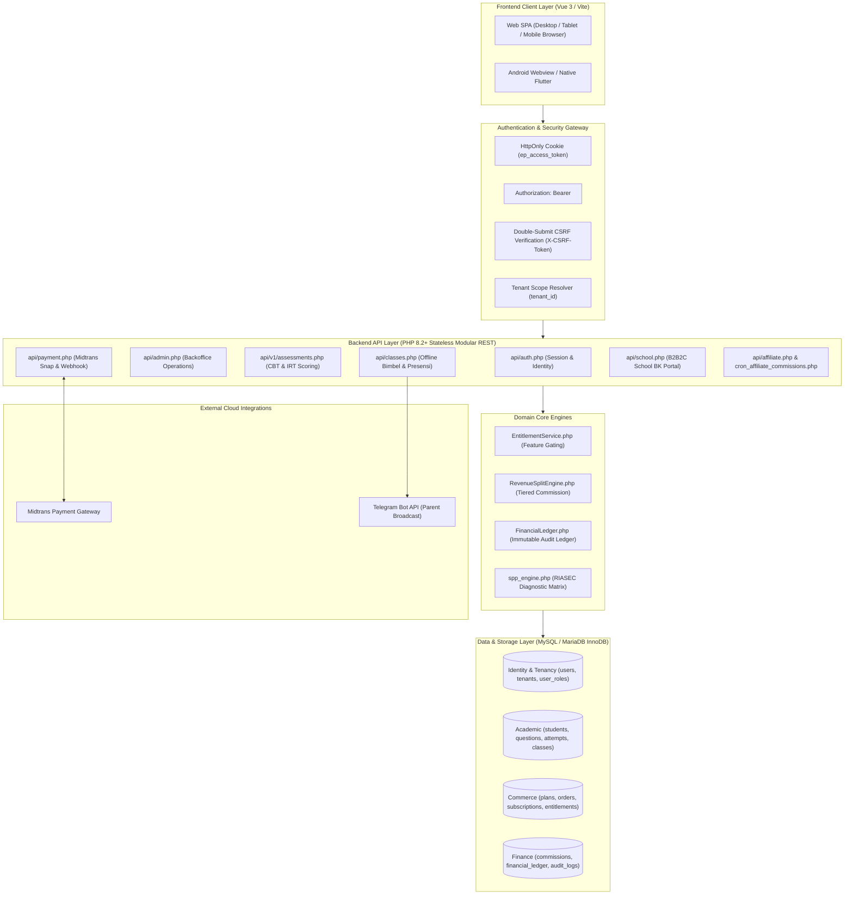

# EDUPATH SYSTEM CONTEXT & AI ENGINEERING BLUEPRINT
**Platform:** EduPath SaaS (Adaptive Learning, IRT 3PL CBT & Offline Bimbel Hybrid)  
**Corpus/Repository:** `yanayuniarsyah/edupath`  
**Target Audience:** External AI Models (Claude, ChatGPT, DeepSeek, Cursor Agent, Windsurf, Copilot, etc.) & Lead Software Engineers  
**Version:** 3.0.0 (Production Architecture Standard)  
**Security & Compliance Level:** Enterprise / Financial Grade / Software Factory Standard

---

## 1. MACHINE-READABLE SYSTEM METADATA

```yaml
system:
  name: "EduPath"
  tagline: "Adaptive Learning & High-Precision CBT IRT UTBK/SNBT Platform"
  business_model: "Hybrid B2C SaaS + B2B2C School Partnership + Offline Branch Bimbel"
  operating_mode: "Software Factory (Strict Lifecycle)"
  architecture_baseline: "v1.1 (Ratified PRD)"
  architecture_baseline_ref: "docs/architecture/EDUPATH_UNIFIED_PRODUCT_ARCHITECTURE_PRD_V1.1.md"
  academic_programs: ["TKA SD", "TKA SMP", "TKA SMA", "SNPMB/UTBK", "SNPMB Alumni"]
  delivery_modes: ["online", "offline", "hybrid"]
  ratified_decisions:
    B1: "Shared Product Catalog (Centralized catalog across all tenants)"
    B2: "Full-Price Upgrade (No proration, new order at full price, independent entitlement periods)"
    B3: "Partner Model: Both (Model 1: Tenant, Model 2: Scoped Operator)"
    B4: "Configurable Cohort Renewal (new_enrollment vs extend_existing)"
tech_stack:
  frontend:
    framework: "Vue.js 3 (Composition API / Options API transition)"
    bundler: "Vite 5+"
    styling: "TailwindCSS 3.x + Vanilla CSS Utilities + Glassmorphism"
    routing: "vue-router (Hash Mode: /#/)"
    http_client: "Fetch API wrapper with in-memory caching and request deduplication (src/api.js)"
  backend:
    runtime: "PHP 8.2+"
    architecture: "Stateless REST API (api/*.php, api/v1/*.php)"
    authentication: "Dual-Mode JWT (HttpOnly Cookie primary for Web, Bearer token for Mobile/API)"
    csrf_protection: "Double-Submit Cookie Pattern (X-CSRF-Token header on mutating requests)"
    database: "MySQL / MariaDB (InnoDB, UTF8mb4)"
    orm_layer: "Native PDO with strict parameter binding (PDO::ATTR_EMULATE_PREPARES => false)"
  integrations:
    payment_gateway: "Midtrans Snap API (Idempotent webhook, pessimistic locking FOR UPDATE)"
    analytics: "Google Analytics 4 (GA4), Meta Pixel"
    notifications: "Telegram Bot API (Parent alerts & attendance)"
    exporting: "DOMPDF / HTML-based Certificate & Rapor Generators"
environments:
  local: "http://localhost:5173 (Vite Dev Server) + PHP built-in/Apache (http://localhost:8000)"
  production: "cPanel / LiteSpeed Web Server (https://edupath.co.id / https://elyana.biz.id)"
```

---

## 2. CORE OPERATING PRINCIPLES & AI GUARDRAILS

Setiap AI eksternal yang membaca, menganalisis, atau menghasilkan kode untuk repositori ini **WAJIB MEMATUHI ATURAN BERIKUT TANPA PENGECUALIAN**:

### 2.1 Siklus Software Factory
Ikuti urutan kerja:
$$\text{PLAN} \longrightarrow \text{SPECIFY} \longrightarrow \text{ARCHITECT} \longrightarrow \text{IMPLEMENT} \longrightarrow \text{TEST} \longrightarrow \text{AUDIT} \longrightarrow \text{FIX} \longrightarrow \text{VERIFY} \longrightarrow \text{DOCUMENT}$$
*Jangan pernah langsung menulis kode sebelum membaca struktur data yang ada dan merumuskan acceptance criteria yang jelas.*

### 2.2 Larangan Mutlak AI (Strict AI Anti-Patterns)
1. **DILARANG MENGARANG SKEMA BASIS DATA**: Jangan pernah berasumsi sebuah kolom atau tabel ada. Selalu rujuk ke skema kanonikal di dokumen ini atau migration file di `api/database/migrations/`.
2. **DILARANG MEMERIKSA `students.plan` SECARA LANGSUNG UNTUK FITUR PREMIUM**:
   - Kolom `plan` pada tabel `students` adalah *legacy representation*.
   - **Source of Truth hak akses adalah tabel `entitlements`** melalui `EntitlementService::hasEntitlement($student_id, $tenant_id, $feature_key)`.
3. **DILARANG MEMBOCORKAN KUNCI JAWABAN KE FRONTEND**:
   - Pada simulasi TryOut CBT atau kuis berbobot, backend **DILARANG KERAS** mengirimkan field `correct`, `explanation`, atau `trick` saat soal dimuat (`GET /api/v1/assessments/*`).
   - Jawaban dan pembahasan hanya boleh dikirim setelah sesi ujian disubmit (`completeAttempt`).
4. **DILARANG REWRITE FILE UTUH TANPA PERSETUJUAN**:
   - File utama seperti `src/App.vue` (>400KB) dan `src/views/AdminPanel.vue` (>400KB) berisi ribuan baris styling dan logika yang stabil.
   - AI harus membuat perubahan secara **surgical (bedah presisi)** menggunakan target baris/fungsi tertentu, bukan me-replace file secara keseluruhan.
5. **DILARANG MENGABAIKAN PESSIMISTIC LOCK PADA MUTASI KEUANGAN**:
   - Semua mutasi saldo, komisi afiliasi, dan status order Midtrans wajib menggunakan transaksi basis data atomik dengan `SELECT ... FOR UPDATE` untuk mencegah *race condition* dan *double-spending*.
6. **DILARANG MEMAKSAKAN PERUBAHAN TAILWIND TANPA MEMPERTAHANKAN DESIGN SYSTEM**:
   - EduPath menggunakan typography Google Font `Outfit`, dark mode slate, glassmorphism (`backdrop-blur-md`), gradien violet/cyan/emerald, dan animasi interaktif (`bouncy-card`, `neon-glow`). Pertahankan estetika premium ini.

### 2.3 Keputusan Arsitektur Terpadu (Ratified PRD v1.1 Baseline)
Berdasarkan dokumen spesifikasi [`docs/architecture/EDUPATH_UNIFIED_PRODUCT_ARCHITECTURE_PRD_V1.1.md`](file:///c:/Users/yanay/OneDrive/Documents/YANA/ELYANA.BIZ.ID/7%20BIMBEL/BIMBEL%20V1/docs/architecture/EDUPATH_UNIFIED_PRODUCT_ARCHITECTURE_PRD_V1.1.md):
1. **B1 — Shared Product Catalog**: Satu master katalog produk pusat untuk seluruh tenant. Tenant menggunakan produk pusat; harga dasar dan definisi paket tidak boleh diubah sepihak per cabang tanpa otorisasi pusat & audit trail.
2. **B2 — Full-Price Upgrade**: Siswa yang upgrade membayar **harga penuh** paket tujuan via order baru. Tidak ada prorata atau pengurangan sisa masa aktif paket lama. Entitlement paket lama tetap berjalan hingga habis masanya, sementara paket baru mendapat periode sendiri.
3. **B3 — Partner Model (Both Supported)**:
   - *Model 1 (Partner as Tenant)*: Beroperasi sebagai tenant mandiri dengan data operasional terisolasi dan admin lokal.
   - *Model 2 (Partner as Scoped Operator)*: Operator yang ditugaskan (*assignment*) oleh tenant pada lokasi/cohort/sesi tertentu tanpa menjadi tenant baru. Akses dapat dicabut (*revoked*) sewaktu-waktu tanpa menghapus data historis.
4. **B4 — Configurable Cohort Renewal**: Setiap penawaran kelas offline mendukung kebijakan:
   - `new_enrollment`: Membuat enrollment baru dan dapat memilih cohort baru.
   - `extend_existing`: Memperpanjang enrollment yang masih eligible tanpa menimpa histori periode sebelumnya.
5. **Unified Academic Engine**: 5 Program Akademik (**TKA SD, TKA SMP, TKA SMA, SNPMB/UTBK, SNPMB Alumni**) lintas 3 mode (**Online, Offline, Hybrid**) menggunakan satu bank soal, satu entitlement engine, dan satu profil kemajuan siswa terpadu.

---

## 3. ARSITEKTUR SISTEM & TOPOLOGI PERAN (RBAC)

### 3.1 Peta Arsitektur Komponen


### 3.2 Batasan Pintu Masuk Peran (RBAC Ingress Gateways)
Sistem memiliki **6 peran pengguna** dengan aturan gerbang login yang terpisah tegas:

| No | Role Code | Target Portal / Route | Mekanisme Login | Otorisasi & Scope Akses |
|:---|:---|:---|:---|:---|
| **1** | `superadmin` | `/#/admin` | Form login admin (`api/admin.php`) | Full access seluruh tenant, master plans, global payout approval, system audit logs. |
| **2** | `admin` | `/#/admin` | Form login admin (`api/admin.php`) | Terikat ke 1 `tenant_id` (cabang). Mengelola kelas offline, jadwal, siswa cabang, dan bank soal lokal. |
| **3** | `teacher` | `/#/` (Home Modal) $\rightarrow$ Tombol Portal Guru | Modal login depan (`api/auth.php`) | Terisolasi ke modul Bank Soal, pembuatan materi, dan monitoring blind spot siswa bimbingan. |
| **4** | `school_bk` | `/#/school` | Portal login sekolah (`api/school.php`) | Akses dashboard kemitraan sekolah, roster siswa per kelas, pemetaan RIASEC angkatan, ekspor rapor PDF. |
| **5** | `student` | `/#/`, `/#/spp`, `/#/tryout` | Modal login depan (`api/auth.php`) | Siswa B2C/B2B. Akses kuis adaptif, SPP, TryOut CBT, pembelian paket Pro, dan materi belajar. |
| **6** | `affiliate` | `/#/` & portal afiliasi | Modal login depan / `api/affiliate.php` | Akses statistik referral, saldo komisi, link referral unik, dan request penarikan dana (payout). |

> [!CRITICAL]
> **ATURAN FORBIDDEN 403 PADA `api/admin.php`**:  
> Jika akun selain `superadmin` dan `admin` mencoba login di `/#/admin`, backend **WAJIB** menolak dengan status HTTP 403. Guru (`teacher`) dan Siswa (`student`) tidak boleh masuk ke portal backoffice administrator.

---

## 4. PETA STRUKTUR REPOSITORI (DIRECTORY & CODEBASE MAP)

```
/ (Workspace Root)
│
├── AI_SYSTEM_CONTEXT.md              # [DOKUMEN INI] Blueprint arsitektur master untuk AI eksternal
├── API_V1_CONTRACT.md                # Standar kontrak API v1
├── EDUPATH_PRODUCT_OVERVIEW.md       # Visi produk, persona pengguna, dan fitur inti
├── package.json                      # Konfigurasi dependensi frontend (Vue, Vite, Tailwind)
├── vite.config.mjs                   # Konfigurasi build Vite & proxy dev server
├── tailwind.config.cjs               # Konfigurasi Tailwind & palet warna
├── index.html                        # Single Page HTML entrypoint
│
├── src/                              # FRONTEND SOURCE CODE (Vue 3)
│   ├── main.js                       # Vue bootstrap, plugin router, inisialisasi Midtrans Snap
│   ├── api.js                        # HTTP client terpusat (Caching, CSRF token, auto-header)
│   ├── index.css                     # Design system tokens, glassmorphism, keyframe animations
│   ├── EduData.js                    # Mock data / fallback catalog PTN & kurikulum
│   ├── App.vue                       # Halaman utama B2C: Landing, Navbar, SPP, Simulator, Studyroom
│   │
│   ├── views/
│   │   ├── AdminPanel.vue            # Backoffice SPA untuk Superadmin & Admin Cabang
│   │   ├── SchoolDashboard.vue       # Portal B2B2C untuk Guru BK & Kepala Sekolah Mitra
│   │   ├── TryOutCBT.vue             # Engine ujian TryOut berbasis CBT dengan timer & ragu-ragu
│   │   ├── TermsView.vue             # Halaman Syarat & Ketentuan hukum
│   │   └── VerifyCertificate.vue    # Verifikator keaslian sertifikat SPP via QR code
│   │
│   └── components/
│       ├── StudentPotentialPath.vue  # Kuesioner tes diagnostik bakat RIASEC & minat jurusan
│       └── MaterialRichEditor.vue    # Rich-text editor untuk penyusunan materi & soal guru
│
├── api/                              # BACKEND REST API (PHP 8.2+)
│   ├── config.php                    # DB connection (PDO), CORS handler, safe_str(), auto-heal DDL
│   ├── env.php                       # Environment variable parser (.env)
│   ├── jwt.php                       # JWT issue, verify, refresh token, Double-Submit CSRF helper
│   ├── EntitlementService.php        # Centralized feature access check (Source of truth izin fitur)
│   ├── RevenueSplitEngine.php        # Kalkulasi bagi hasil komisi afiliasi & biaya gateway
│   ├── FinancialLedger.php           # Buku besar akuntansi keuangan ganda (immutable ledger)
│   ├── rate_limit.php                # Proteksi brute force & rate limiting IP
│   ├── auth.php                      # Endpoint pendaftaran & login siswa, guru, afiliasi
│   ├── admin.php                     # Endpoint backoffice admin & superadmin
│   ├── payment.php                   # Midtrans checkout, Full-Price Upgrade & webhook listener (atomic + lock)
│   ├── plans.php                     # Central Shared Product Catalog consumer endpoint
│   ├── plan.php                      # Admin backoffice catalog management (AC-01 & AC-02 compliance)
│   ├── programs.php                  # Master Academic Programs (TKA SD, SMP, SMA, SNPMB/UTBK, Alumni)
│   ├── classes.php                   # Modul manajemen rombel, jadwal & presensi bimbel offline
│   ├── school.php                    # Modul B2B kemitraan sekolah & analitik angkatan
│   ├── spp.php & spp_service.php     # Diagnostik SPP & kalkulator kelulusan PTN
│   ├── materials.php                 # Modul pembelajaran materi berjenjang
│   ├── quiz.php                      # Mini kuis harian & latihan soal
│   │
│   ├── v1/                           # V1 STANDARDIZED API
│   │   ├── assessments.php           # Siklus TryOut CBT formal (start attempt, submit, IRT scoring)
│   │   └── scoring/                  # Algoritma IRT 3PL & CTT
│   │
│   └── database/
│       ├── database.sql              # Base dump tabel dasar
│       ├── schema_offline_classes.sql# Skema rombel bimbel, presensi & kelas offline
│       └── migrations/               # Riwayat evolusi skema bertahap (Phase 1 s/d Phase 11)
│
└── docs/                             # DOKUMENTASI HISTORIS & AUDIT
    ├── ANALISA_BISNIS_PROSES_DAN_KONDISI_IDEAL_SISTEM.md
    ├── PANDUAN_FUNGSI_DAN_BISNIS_PROSES_SEMUA_ROLE.md
    └── architecture/EDUPATH-TARGET-ARCHITECTURE.md
```

---

## 5. SKEMA BASIS DATA KANONIKAL & RELASI ENTITAS

### 5.1 Entitas Identitas & Multi-Tenancy
- **`tenants`**: Cabang fisik bimbel atau entitas organisasi.
  - Columns: `id (UUID PK)`, `name (VARCHAR 150)`, `slug (VARCHAR 100 UNIQUE)`, `is_active (TINYINT 1)`.
- **`users`**: Master identitas akun tunggal (Unified Identity).
  - Columns: `id (UUID PK)`, `identity_key (VARCHAR 150 UNIQUE - email/username)`, `display_name`, `password (bcrypt)`, `is_active`, timestamps.
- **`user_roles`**: Pemetaan peran dinamis pengguna ke tenant tertentu.
  - Columns: `id (UUID PK)`, `user_id (FK users.id)`, `tenant_id (FK tenants.id NULLable)`, `role ('superadmin','admin','teacher','school_bk','student','affiliate')`, `reference_id (UUID entitas spesifik)`.
- **`admins`**: Entitas admin internal.
  - Columns: `id (UUID PK)`, `username UNIQUE`, `password`, `name`, `tenant_id (FK tenants.id)`.
- **`students`**: Entitas profil siswa B2C / B2B.
  - Columns: `id (UUID PK)`, `name`, `email UNIQUE`, `password`, `phone`, `school_id (FK schools.id NULLable)`, `tenant_id (FK tenants.id NULLable)`, `target_ptn`, `plan ('free','pro')`, `streak`, `coins`, `total_score`, `telegram_chat_id`, `parent_telegram_id`, `is_active`.
- **`schools`**: Entitas sekolah mitra B2B2C.
  - Columns: `id (UUID PK)`, `tenant_id`, `name`, `npsn`, `city`, `province`, `bk_coordinator_name`, `bk_coordinator_phone`, `is_active`.

### 5.2 Entitas Komersial, Hak Akses & Keuangan
- **`academic_programs`**: Master 5 Program Akademik Pusat (TKA SD, TKA SMP, TKA SMA, SNPMB/UTBK, SNPMB Alumni).
  - Columns: `id (UUID PK)`, `code UNIQUE`, `name`, `description`, `target_level ('SD','SMP','SMA','ALUMNI')`, `subject_config (JSON)`, `status`.
- **`plans`**: Katalog paket produk pusat (Shared Product Catalog - B1).
  - Columns: `id (UUID PK)`, `tenant_id (NULL = Central Catalog)`, `program_id`, `academic_program`, `package_code`, `delivery_mode ('online','offline','hybrid')`, `name`, `price`, `base_price`, `discount`, `duration`, `duration_value`, `duration_unit`, `features (JSON)`, `components (JSON)`, `currency`, `version`, `status`, `is_active`, `is_archived`.
- **`tenant_product_overrides`**: Mekanisme penyesuaian harga khusus cabang tanpa mengubah harga dasar katalog pusat (AC-01, AC-02).
  - Columns: `id (UUID PK)`, `tenant_id`, `plan_id`, `override_price`, `currency`, `reason`, `authorized_by`, `status`, `effective_from`, `effective_until`.
- **`orders`**: Transaksi pemesanan paket langganan (Snapshot C5 & Upgrade B2).
  - Columns: `id (UUID PK)`, `order_id (VARCHAR UNIQUE)`, `student_id (FK students.id)`, `tenant_id`, `plan_id (FK plans.id)`, `amount (FLOAT)`, `status ('pending','paid','failed','refunded')`, `snap_token`, `payment_method`, `referral_code`, `order_type ('new_purchase','upgrade','renewal')`, `package_version`, `purchase_snapshot (JSON)`, `upgrade_from_order_id`, timestamps.
- **`upgrade_audit_logs`**: Jejak audit transisi upgrade paket siswa (AC-06).
  - Columns: `id (UUID PK)`, `student_id`, `tenant_id`, `from_order_id`, `from_plan_id`, `to_order_id`, `to_plan_id`, `from_plan_name`, `to_plan_name`, `upgrade_price_paid`, `previous_expires_at`, `new_expires_at`, `metadata (JSON)`, `created_at`.
- **`subscriptions`**: Siklus hidup kepemilikan paket siswa.
  - Columns: `id (UUID PK)`, `student_id (FK students.id)`, `plan_id (FK plans.id)`, `order_id (FK orders.id)`, `status ('active','expired','cancelled')`, `starts_at`, `expires_at`.
- **`entitlements`**: **Hak akses aktual per fitur siswa (Source of Truth)**.
  - Columns: `id (UUID PK)`, `student_id (FK students.id)`, `feature_key ('tryout_unlimited','ai_adaptive_path','spp_full','studyroom_access')`, `subscription_id (FK subscriptions.id NULLable)`, `revoked_at (TIMESTAMP NULLable)`, `expires_at (TIMESTAMP NULLable)`.
- **`financial_ledger`**: Catatan pembukuan akuntansi ganda (*immutable*).
  - Columns: `id (UUID PK)`, `order_id`, `tenant_id`, `channel`, `entry_type ('GROSS_SALES','GATEWAY_FEE','ROYALTY_EXPENSE','COMMISSION_EXPENSE','NET_REVENUE')`, `party_type ('STUDENT_PAYMENT','GATEWAY','AUTHOR','AFFILIATE','PLATFORM')`, `party_id`, `amount (DECIMAL 12,2)`, `is_credit (TINYINT 1)`, `rule_snapshot (JSON)`, `status ('posted','reversed')`.
- **`affiliates` & `commissions`**:
  - `affiliates`: `id (UUID PK)`, `user_id`, `referral_code UNIQUE`, `commission_rate (FLOAT e.g. 0.20)`, `balance`, `bank_name`, `bank_account_number`, `bank_account_holder`.
  - `commissions`: `id (UUID PK)`, `affiliate_id`, `order_id`, `amount`, `status ('pending','approved','paid','rejected')`.

### 5.3 Entitas Akademik, Soal & CBT IRT
- **`questions`**: Master Bank Soal Universal.
  - Columns: `id (UUID PK)`, `jenjang ('SMA','SMP')`, `kurikulum ('Merdeka','K13')`, `subtes (e.g. 'Penalaran Matematika')`, `bab`, `difficulty ('easy','medium','hard')`, `cognitive_demand ('C1'-'C6')`, `irt_score (FLOAT)`, `irt_a (Diskriminasi)`, `irt_b (Tingkat Kesulitan)`, `irt_c (Tebakan Semu)`, `question (TEXT)`, `option_a`, `option_b`, `option_c`, `option_d`, `option_e`, `correct ('A'-'E')`, `explanation (TEXT)`, `trick (TEXT)`, `source_name`, `source_year`, `is_active`, `is_qc_passed`.
- **`assessment_attempts` & `assessment_responses`** (Siklus CBT v1):
  - `assessment_attempts`: `id (UUID PK)`, `student_id`, `assessment_id`, `status ('in_progress','completed','abandoned')`, `started_at`, `finished_at`, `raw_score`, `irt_scaled_score`.
  - `assessment_responses`: `id (UUID PK)`, `attempt_id`, `question_id`, `selected_option ('A'-'E')`, `is_flagged (Ragu-ragu)`, `time_spent_sec`, `is_correct`.

### 5.4 Entitas Kelas Bimbel Offline, Presensi & Renewal (Phase 3 & Phase 5)
- **`class_rooms`**: Ruang kelas fisik cabang (`id`, `tenant_id`, `name`, `capacity`, `is_active`).
- **`classes`**: Rombongan belajar (`id`, `tenant_id`, `name`, `academic_year`, `default_room_id`, `max_capacity`, `status`).
- **`class_offerings`**: Paket penawaran kelas offline yang mengaitkan program akademik, paket produk, rombel, kapasitas, dan kebijakan renewal (`id`, `tenant_id`, `program_id`, `academic_program`, `plan_id`, `class_id`, `name`, `renewal_mode ('new_enrollment','extend_existing')`, `max_capacity`, `registration_open_at`, `registration_close_at`, `status`).
- **`class_students`**: Anggota siswa di rombel (`id`, `class_id`, `student_id`, `joined_at`, `valid_until`, `offering_id`, `renewal_reference_id`, `status ('active','completed','transferred','dropped')`).
- **`class_sessions`**: Sesi pertemuan tatap muka (`id`, `class_id`, `room_id`, `teacher_id`, `session_date`, `start_time`, `end_time`, `subject`, `status ('scheduled','in_progress','completed','cancelled','rescheduled')`).
- **`session_attendances`**: Rekam presensi kehadiran fisik (`id`, `session_id`, `student_id`, `attendance_status ('present','late','absent','excused')`, `minutes_late`, `notes`, `check_in_time`).
- **`makeup_requests`**: Pengajuan kelas pengganti/inval siswa terbatas kuota (AC-15: maks 2 per periode, validasi kapasitas sesi pengganti).
- **`renewal_policies`**: Kebijakan perpanjangan rombel per offering (AC-11: `renewal_mode`, `renewal_price`, `extension_days`, `allowed_cohort_change`, `eligibility_rule`, `open_at`, `close_at`).
- **`renewal_records`**: Histori perpanjangan rombel siswa (AC-12 & AC-13: `original_enrollment_id`, `new_enrollment_id`, `student_id`, `offering_id`, `renewal_mode`, `previous_class_id`, `new_class_id`, `previous_end_date`, `new_end_date`, `price_paid`, `order_id`).

### 5.5 Entitas Kemitraan Ganda (Dual Partner Operating Models - Phase 4)
- **`partner_profiles`**: Profil mitra EduPath (Model 1: Tenant terpisah vs Model 2: Scoped Operator).
  - Columns: `id (UUID PK)`, `partner_type ('tenant','scoped_operator')`, `name`, `code UNIQUE`, `tenant_id`, `user_id`, `contact_email`, `contact_phone`, `status ('active','suspended','terminated')`, `revenue_share_pct`, `notes`.
- **`partner_assignments`**: Penugasan spesifik untuk Scoped Operator (AC-09, AC-10).
  - Columns: `id (UUID PK)`, `partner_id`, `operator_user_id`, `tenant_id`, `location`, `offering_id`, `class_id`, `session_id`, `start_date`, `end_date`, `status ('active','revoked','expired')`, `revoked_at`, `revoked_by`, `revocation_reason`, `created_by`.
- **`partner_assignment_logs`**: Jejak audit penugasan dan pencabutan hak akses mitra (AC-10: *revocation terminates access without deleting history*).

---

## 6. STANDAR PROTOKOL API & FORMAT RESPONSE

### 6.1 Format Standard Envelope
Semua endpoint PHP di `/api/` dan `/api/v1/` wajib mengembalikan payload JSON dengan envelope standar:

**Berhasil (HTTP 200 / 201):**
```json
{
  "success": true,
  "data": {
    "user_id": "9b1deb4d-3b7d-4bad-9bdd-2b0d7b3dcb6d",
    "name": "Budi Pratama",
    "entitlements": ["tryout_unlimited", "spp_full"]
  }
}
```

**Gagal (HTTP 400 / 401 / 403 / 404 / 422 / 500):**
```json
{
  "success": false,
  "error": {
    "code": "INSUFFICIENT_ENTITLEMENT",
    "message": "Fitur ini memerlukan paket Pro Aktif. Silakan upgrade paket Anda."
  }
}
```

### 6.2 Mekanisme Autentikasi & Double-Submit CSRF
1. **Login Request**:
   - `POST /api/auth.php?action=login` menerima `{ "email": "...", "password": "..." }`.
   - Mengatur HttpOnly cookie: `ep_access_token` (Secure, SameSite=Lax).
   - Mengembalikan `csrf_token` dalam JSON response.
2. **Mutasi Request (POST, PUT, DELETE, PATCH)**:
   - Client Web wajib menyertakan header: `X-CSRF-Token: <csrf_token>` (disimpan di `sessionStorage`).
   - Client Mobile/API eksternal menyertakan: `Authorization: Bearer <token>`.
3. **Backend Validation (`api/jwt.php`)**:
   - Fungsi `authenticate()` memvalidasi token dari header `Authorization` terlebih dahulu, lalu fallback ke `$_COOKIE['ep_access_token']`.
   - Fungsi `verify_csrf()` memastikan token header cocok dengan `$_COOKIE['ep_csrf_token']` jika menggunakan autentikasi cookie.

### 6.3 Daftar Endpoint Kunci Sistem

| Domain | Metode & Path | Akses Peran | Deskripsi Fungsional |
|:---|:---|:---|:---|
| **Auth** | `POST /api/auth.php?action=login` | Public | Login Siswa, Guru, Afiliasi (Set HttpOnly Cookie + CSRF) |
| **Auth** | `POST /api/auth.php?action=register` | Public | Pendaftaran Siswa baru |
| **Auth** | `GET /api/auth.php?action=me` | Authenticated | Ambil info sesi aktif, peran, dan status profil |
| **Auth** | `POST /api/auth.php?action=logout` | Authenticated | Hapus cookie autentikasi & revoke refresh token |
| **Admin** | `POST /api/admin.php?action=login` | Admin/Super | Login backoffice portal `/#/admin` |
| **Admin** | `GET /api/admin.php?action=dashboard_stats` | Admin/Super | Statistik siswa, omzet, dan rombel cabang |
| **Assess** | `GET /api/v1/assessments/{slug}` | Student | Ambil konfigurasi TryOut & daftar soal (*KUNCI DIRAHASIAKAN*) |
| **Assess** | `POST /api/v1/assessments/{id}/attempts` | Student | Mulai sesi pengerjaan TryOut (Validasi entitlement) |
| **Assess** | `POST /api/v1/attempts/{id}/responses` | Student | Simpan autosave jawaban / ragu-ragu real-time |
| **Assess** | `POST /api/v1/attempts/{id}/complete` | Student | Selesaikan sesi ujian & jalankan komputasi skor IRT 3PL |
| **Assess** | `GET /api/v1/attempts/{id}/result` | Student | Ambil hasil akhir skor IRT, kunci jawaban, dan pembahasan |
| **Catalog**| `GET /api/programs.php` | Public | Master 5 Program Akademik Pusat (TKA SD, SMP, SMA, UTBK, Alumni) |
| **Catalog**| `GET /api/plans.php` | Public | Shared Product Catalog (Katalog pusat + override tenant) |
| **Catalog**| `POST/PUT /api/plan.php` | Superadmin Only | Manajemen master katalog pusat (Tenant ditolak 403 AC02) |
| **Payment**| `GET /api/payment.php?action=upgrade_eligibility` | Student | Validasi kelayakan upgrade ke harga penuh tanpa prorata (AC-04, AC-05) |
| **Payment**| `POST /api/payment.php?action=create` | Student | Order checkout paket baru / upgrade dengan snapshot produk (AC-03) |
| **Payment**| `POST /api/payment.php?action=webhook` | Midtrans Server | Listener notifikasi Midtrans (Pessimistic lock, upgrade audit, idempotency AC-07) |
| **Payment**| `GET /api/payment.php?action=purchase_history` | Student | Riwayat lengkap pembelian dan snapshot order |
| **Offline**| `GET/POST /api/classes.php?action=offerings` | Admin / Student | Daftar paket penawaran kelas offline & kapasitas all_sessions (AC-11, AC-14) |
| **Offline**| `GET/POST /api/classes.php?action=makeup_requests` | Student / Admin | Pengajuan dan persetujuan kelas pengganti/inval siswa (AC-15) |
| **Partners**| `GET/POST /api/partners.php?action=list` | Admin / Super | Kelola profil mitra (Model 1: Tenant vs Model 2: Operator - AC-08) |
| **Partners**| `POST /api/partners.php?action=create_assignment` | Admin / Super | Tugaskan operator ke lokasi, offering, rombel, atau sesi (AC-09) |
| **Partners**| `POST /api/partners.php?action=revoke_assignment` | Admin / Super | Cabut tugas operator seketika tanpa menghapus histori (AC-10) |
| **Partners**| `GET /api/partners.php?action=my_assignments` | Operator | Lihat penugasan aktif operator yang sedang berlaku |
| **Renewal**| `GET /api/classes.php?action=renewal_options` | Student / Admin | Opsi perpanjangan rombel siswa (new_enrollment vs extend_existing) |
| **Renewal**| `POST /api/classes.php?action=renew_enrollment` | Student / Admin | Eksekusi perpanjangan rombel secara atomik (AC-12, AC-13) |
| **Renewal**| `GET /api/classes.php?action=renewal_history` | Student / Admin | Riwayat lengkap perpanjangan rombel siswa |
| **Progress**| `GET /api/progress.php?action=unified` | Student / Staf | **Unified Student Progress**: Penggabungan materi, CBT, kehadiran offline, dan SPP (AC-16, AC-17) |
| **School** | `GET /api/school.php?action=cohort_stats` | School BK | Laporan sebaran minat jurusan dan riasec angkatan siswa |

---

## 7. ATURAN BISNIS & FORMULA MATEMATIS

### 7.1 Algoritma Penilaian IRT 3-Parameter Logistic (3PL)
Penilaian TryOut EduPath menggunakan model respons butir (IRT 3PL):
$$P_i(\theta) = c_i + \frac{1 - c_i}{1 + e^{-1.7 \cdot a_i \cdot (\theta - b_i)}}$$
*Keterangan parameter:*
- $\theta$ (*theta*): Estimasi kemampuan siswa (skala -3.00 hingga +3.00, ditransformasikan ke skala SNBT 200 - 1000).
- $a_i$: Daya pembeda butir soal (*discrimination parameter*).
- $b_i$: Tingkat kesulitan butir soal (*difficulty parameter*).
- $c_i$: Peluang tebakan semu (*pseudo-guessing parameter*).

### 7.2 Formula Pembagian Pendapatan (Revenue Split Engine)
Pada setiap transaksi sukses (`settlement`), `RevenueSplitEngine.php` menghitung pembagian secara deterministik:
1. **Nilai Bruto (Gross Amount)**: Harga paket yang dibayar siswa.
2. **Biaya Gateway (Gateway Fee)**: Dipotong langsung (Midtrans QRIS 0.7%, VA fixed Rp 4.000).
3. **Net Distributable Revenue** = $\text{Gross Amount} - \text{Gateway Fee}$.
4. **Alokasi Komisi Afiliasi (jika menggunakan referral code)**:
   $$\text{Komisi Afiliasi} = \text{Net Distributable} \times \text{Rate Afiliasi (default: 20\%)}$$
5. **Alokasi Royalti Penulis Konten (jika soal berbayar)**: 5% dari Net Distributable.
6. **Laba Bersih Platform (Net Platform Revenue)** = Sisa dana setelah semua kewajiban terpotong.
*Semua entri ini diposting ke tabel `financial_ledger` dalam 1 transaksi PDO.*

---

## 8. PANDUAN KERJA (RECIPES) UNTUK AI EKSTERNAL

Jika Anda (AI) diminta melakukan tugas pengembangan pada sistem EduPath, gunakan resep berikut:

### Resep A: Menambahkan Endpoint Backend Baru (PHP)
1. Tentukan letak file: Jika terkait domain lama, tambahkan ke `api/{domain}.php`. Jika endpoint REST terstandarisasi, gunakan `api/v1/{resource}.php`.
2. Sertakan dependensi wajib:
   ```php
   require_once __DIR__ . '/config.php';
   require_once __DIR__ . '/jwt.php';
   require_once __DIR__ . '/EntitlementService.php';
   ```
3. Lakukan autentikasi dan validasi role:
   ```php
   $user = authenticate();
   if ($user->role !== 'student') {
       http_response_code(403);
       echo json_encode(["success" => false, "error" => ["code" => "FORBIDDEN", "message" => "Akses ditolak."]]);
       exit;
   }
   ```
4. Jika endpoint memodifikasi data (POST/PUT/DELETE), jalankan `verify_csrf()`.
5. Sanitasi semua input string menggunakan `safe_str($input)` dari `config.php` untuk mencegah fatal error di PHP 8.2+.
6. Gunakan *prepared statements* dengan PDO. Hindari string interpolation SQL.

### Resep B: Menambahkan Fitur pada Frontend Vue (`src/App.vue` atau `AdminPanel.vue`)
1. **JANGAN menimpa seluruh file.** Temukan blok kode spesifik yang relevan.
2. Gunakan `src/api.js` untuk komunikasi data:
   ```javascript
   import { apiRequest } from './api.js';
   // Contoh GET:
   const res = await apiRequest('/api/v1/assessments/snbt-2026');
   // Contoh POST dengan CSRF otomatis:
   const saveRes = await apiRequest('/api/classes.php?action=save', {
     method: 'POST',
     body: JSON.stringify(formData)
   });
   ```
3. Pertahankan UI library yang sudah ada: Font Outfit, Lucide/Heroicons SVG inline, dan kelas Tailwind `bg-slate-900`, `border-slate-800`, `text-cyan-400`.

### Resep C: Melakukan Modifikasi Skema Basis Data
1. Buat file migration SQL / PHP baru di `api/database/migrations/` dengan penamaan terurut (misal: `phase10_feature_name.sql`).
2. Pastikan DDL menggunakan klausa `IF NOT EXISTS` atau pengecekan kolom via `information_schema`.
3. Daftarkan perubahan tabel ke fungsi `ensure_core_schema_sync()` di `api/config.php` jika tabel tersebut sangat krusial agar sistem dapat auto-heal di hosting cPanel.

---

## 9. TEMPLATE PROMPT AWAL UNTUK MEMANGGIL AI EKSTERNAL

Salin teks di bawah ini sebagai **System Prompt** atau **Initial Instructions** saat Anda berinteraksi dengan AI eksternal (seperti Claude, ChatGPT, Cursor, dsb.):

```text
Kamu adalah Senior Software Engineer yang bertugas mengembangkan sistem "EduPath" (repositori: yanayuniarsyah/edupath).
Sebelum memberikan jawaban atau menulis kode, kamu WAJIB membaca dan mematuhi seluruh spesifikasi di file AI_SYSTEM_CONTEXT.md.

ATURAN UTAMA:
1. Stack: Vue 3 (Vite + Tailwind) di frontend, PHP 8.2+ stateless REST API di backend, MySQL InnoDB di database.
2. Jangan pernah mengarang tabel atau kolom database. Rujuk skema di AI_SYSTEM_CONTEXT.md.
3. Hak akses fitur WAJIB dicek via EntitlementService::hasEntitlement(), BUKAN memeriksa kolom students.plan.
4. Kunci jawaban soal CBT TryOut DILARANG dikirim ke frontend sebelum ujian disubmit.
5. Mutasi transaksi keuangan Midtrans WAJIB atomik dengan pessimistic locking (FOR UPDATE) dan tercatat di financial_ledger.
6. Lakukan perubahan kode secara minimal, presisi (surgical), dan pertahankan design system yang ada tanpa melakukan full-file rewrite.
7. Ikuti alur Software Factory: PLAN -> SPECIFY -> ARCHITECT -> IMPLEMENT -> TEST -> AUDIT -> FIX -> VERIFY -> DOCUMENT.
```

---
*Dokumen ini adalah single source of truth arsitektur EduPath yang dirancang khusus untuk memandu AI eksternal agar analisis dan kode yang dihasilkan 100% presisi, aman, dan selaras dengan sistem produksi.*
