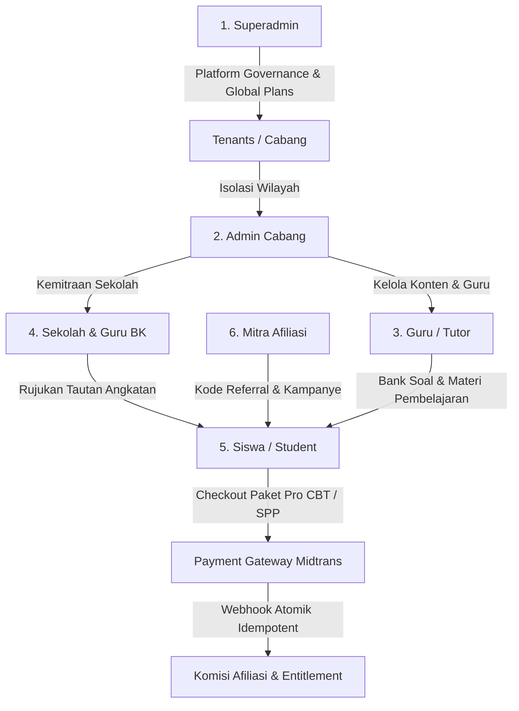

# DOKUMEN ANALISA BISNIS PROSES & KONDISI IDEAL SISTEM EDUPATH
**Versi:** 1.0.0  
**Tanggal:** 24 Oktober 2026  
**Status:** Dokumen Resmi Hasil Forensik & Desain Target Arsitektur  
**Platform:** EduPath SaaS (Adaptive Learning & CBT IRT Platform)

---

## 1. RINGKASAN EKSEKUTIF (EXECUTIVE SUMMARY)

Dokumen ini menyajikan hasil audit mendalam terhadap seluruh proses bisnis lintas peran (*roles*) pada ekosistem **EduPath**, serta merumuskan **Kondisi Ideal Sistem (*Target State Architecture*)** yang seharusnya diterapkan untuk mencapai standar *Production-Grade EdTech Enterprise SaaS*.

EduPath mengoperasikan model bisnis hibrida:
1. **B2C SaaS**: Akuisisi langsung siswa SMA/Gap Year via freemium, mini-kuis, diagnostik potensi belajar (SPP), dan konversi ke paket berbayar Pro CBT IRT.
2. **B2B2C School Partnership**: Kemitraan strategis dengan Sekolah Menengah Atas dan Guru Bimbingan Konseling (BK) untuk pemetaan angkatan secara massal.
3. **Affiliate Distribution Network**: Program kemitraan berinsentif komisi bertingkat untuk mengakselerasi pertumbuhan organik.

---

## 2. PEMETAAN BISNIS PROSES & MATRIKS AKSES ANTAR ROLE

Dalam basis data (`user_roles`) dan lapisan implementasi kode, terdapat **6 peran pengguna** utama:

---

### A. Peran Siswa (`student`) — Konsumen Akhir (B2C)
* **Pintu Masuk & Portal**: Halaman utama SPA (`/#/`, `/#/spp`, `/#/tryout`). Autentikasi melalui modal login/registrasi di [`src/App.vue`](file:///c:/Users/yanay/OneDrive/Documents/YANA/ELYANA.BIZ.ID/7%20BIMBEL/BIMBEL%20V1/src/App.vue).
* **Alur Bisnis Proses**:
  1. **Lead Generation & Onboarding**:
     * Siswa dapat mencoba simulator peluang lolos PTN AI dan mini quiz HOTS secara gratis tanpa registrasi rumit.
     * Mengikuti tes awal **Student Potential Path (SPP)** secara mandiri atau melalui tautan rujukan sekolah.
     * Mengisi profil: Asal sekolah, target universitas/program studi impian, no WhatsApp, dan kode referral afiliasi.
  2. **Tingkatan Akses (Freemium vs Pro)**:
     * **Siswa Free**: Akses kuis latihan dasar, materi terbuka, kalkulator passing grade, serta gamifikasi *streak* & koin.
     * **Siswa Pro/Berbayar (`Pejuang PTN`, `Mandiri`, `Elite`)**: Membuka gembok seluruh subtes UTBK/SNBT, modul materi premium, simulasi CBT Tryout berbobot IRT (*Item Response Theory*), detektor kelemahan konsep (*AI Blind Spot Detector*), serta pembahasan trik kilat.
  3. **Transaksi & Pembayaran**:
     * Memilih paket langganan -> sistem membuat order ke Midtrans Snap -> Siswa menyelesaikan pembayaran -> Webhook backend memvalidasi *signature* dan memicu mutasi status menjadi aktif, menerbitkan *Subscription* & *Entitlement*.

---

### B. Peran Sekolah & Guru BK (`school_bk` / `teacher`) — Mitra B2B2C
* **Pintu Masuk & Portal**: Portal mandiri `/#/school` didukung oleh [`src/views/SchoolDashboard.vue`](file:///c:/Users/yanay/OneDrive/Documents/YANA/ELYANA.BIZ.ID/7%20BIMBEL/BIMBEL%20V1/src/views/SchoolDashboard.vue) dan backend [`api/school.php`](file:///c:/Users/yanay/OneDrive/Documents/YANA/ELYANA.BIZ.ID/7%20BIMBEL/BIMBEL%20V1/api/school.php).
* **Alur Bisnis Proses**:
  1. **Registrasi Kemitraan**: Pendaftaran akun sekolah oleh koordinator Guru BK (NPSN, nama koordinator BK, kontak WA, email institusi).
  2. **Tautan Khusus Rujukan Angkatan**:
     * Sekolah memperoleh tautan khusus: `https://edupath.co.id/?school={NamaSekolah}#/spp`.
     * Setiap siswa yang mendaftar melalui tautan ini secara otomatis terikat dengan `school_id` sekolah tersebut.
  3. **Dashboard Monitoring & Analitik Kohort**:
     * **KPI Agregat**: Jumlah total siswa terdata, proporsi paket gratis vs paket berbayar, jumlah peserta tryout, dan skor rata-rata tryout angkatan.
     * **Distribusi Psikometrik RIASEC**: Peta kecenderungan bakat & tipe kepribadian siswa (Realistic, Investigative, Artistic, Social, Enterprising, Conventional) dari asesmen SPP.
     * **Peta Target Kampus**: Daftar 5 universitas dan jurusan teratas yang paling diminati siswa di sekolah tersebut.
     * **Roster Siswa**: Rincian nama siswa, nomor WhatsApp, status keaktifan paket bimbel, kode RIASEC, dan nilai CBT tryout terbaru.
  4. **Pelaporan**: Fasilitas ekspor rekap data siswa binaan ke format CSV/Excel untuk keperluan bimbingan konseling dan laporan pimpinan sekolah.

---

### C. Peran Guru / Tutor (`teacher` / `tutor`) — Pendidik & Kontributor Konten
* **Pintu Masuk & Portal**: Portal Pengajar melalui `/#/admin` (tampilan terfilter) via [`src/views/AdminPanel.vue`](file:///c:/Users/yanay/OneDrive/Documents/YANA/ELYANA.BIZ.ID/7%20BIMBEL/BIMBEL%20V1/src/views/AdminPanel.vue).
* **Alur Bisnis Proses**:
  1. **Autentikasi Terpisah**: Masuk melalui portal login dengan hak akses khusus pendidik.
  2. **Manajemen Bank Soal Mandiri**: Menyusun dan memperbarui soal latihan/tryout dengan atribusi pengajar (`teacher_id`, `teacher_name`), menentukan tingkat kesulitan, dimensi kognitif (C1–C6), dan pembahasan konseptual.
  3. **Manajemen Materi Pembelajaran**: Mengunggah modul bacaan, materi teks terstruktur, tautan video pembelajaran, dan indikator materi.
  4. **Teacher Hub**: Memonitor jadwal mengajar dan kemajuan belajar siswa bimbingan.
  5. **Restriksi**: Dibatasi ketat dari melihat transaksi keuangan, pengaturan paket bimbel, komisi afiliasi, maupun konfigurasi platform pusat.

---

### D. Peran Mitra Afiliasi (`affiliate`) — Kanal Distribusi Organik
* **Pintu Masuk & Portal**: Portal Afiliasi independen ([`affiliate.html`](file:///c:/Users/yanay/OneDrive/Documents/YANA/ELYANA.BIZ.ID/7%20BIMBEL/BIMBEL%20V1/affiliate.html) / `public/affiliate_dashboard.html`) atau via tab afiliasi di `/#/admin`. Backend: [`api/affiliate.php`](file:///c:/Users/yanay/OneDrive/Documents/YANA/ELYANA.BIZ.ID/7%20BIMBEL/BIMBEL%20V1/api/affiliate.php).
* **Alur Bisnis Proses**:
  1. **Pendaftaran**: Siswa dapat mengaktifkan akun afiliasi, atau pihak eksternal (agen, alumni, kreator konten) mendaftar sebagai mitra.
  2. **Penerbitan Referral**: Sistem men-generate `referral_code` unik dan tautan promosi `?ref=KODE`.
  3. **Engine Komisi Otomatis**:
     * Transaksi perdana siswa yang dirujuk: komisi **20%**.
     * Perpanjangan (*renewal*): komisi **10%**.
     * Kalkulasi komisi dilakukan strictly di backend menggunakan presisi `bcmath` di dalam transaksi atomik webhook Midtrans.
  4. **Pencairan Saldo (*Payout*)**:
     * Mitra mendaftarkan detail rekening bank (Bank, No Rekening, Nama Pemilik).
     * Dapat mengajukan *Payout* jika saldo komisi berstatus *pending* telah mencapai batas minimal (Rp 50.000).
     * Sistem mengunci komisi terkait dengan mekanisme alokasi FIFO (*First-In-First-Out*).

---

### E. Peran Admin Cabang / Tenant (`admin`) — Operasional Wilayah
* **Pintu Masuk & Portal**: Portal `/#/admin` dengan isolasi tenant ([`api/admin.php`](file:///c:/Users/yanay/OneDrive/Documents/YANA/ELYANA.BIZ.ID/7%20BIMBEL/BIMBEL%20V1/api/admin.php)).
* **Alur Bisnis Proses**:
  1. **Isolasi Data (*Tenant Scoping*)**: Akses dibatasi secara tegas oleh parameter `tenant_id`. Admin cabang A tidak dapat melihat data siswa atau omzet cabang B.
  2. **Operasional Cabang**: Mengelola sekolah mitra di wilayahnya, memvalidasi pendaftaran siswa cabang, memantau bank soal dan materi relevan cabang, serta memantau omzet transaksi dan rujukan afiliasi cabang.
  3. **Restriksi**: Tidak memiliki wewenang membuat cabang baru, membuat paket global, atau menambah akun administrator lain.

---

### F. Peran Superadmin (`superadmin`) — Tata Kelola Platform Global
* **Pintu Masuk & Portal**: Portal `/#/admin` dengan wewenang tak terbatas (*Platform-Wide*).
* **Alur Bisnis Proses**:
  1. **Governance Cabang & Tenant**: Menambah, mengaktifkan, dan menonaktifkan cabang bimbel (`tenants`).
  2. **Monetisasi & Packaging**: Mengatur paket langganan (`plans`), penetapan harga, durasi, diskon, dan pemetaan hak akses fitur (*Entitlements*).
  3. **Quality Control Konten**: Melakukan audit QC terhadap bank soal nasional, memverifikasi pembobotan IRT, dan taksonomi materi.
  4. **Audit Finansial & Persetujuan Payout**: Rekonsiliasi transaksi pembayaran Midtrans, audit ledger komisi, dan memproses persetujuan pencairan dana (*payout*) afiliasi.
  5. **Manajemen Staff & Keamanan**: Mengelola akun staf internal (admin cabang, pengajar), memantau log audit, rate limit, dan mencadangkan/memulihkan basis data.

---

## 3. MATRIKS KOMPARATIF HAK AKSES FITUR

| Fitur / Modul | Siswa | Guru BK / Sekolah | Guru / Tutor | Mitra Afiliasi | Admin Cabang | Superadmin |
| :--- | :---: | :---: | :---: | :---: | :---: | :---: |
| **SPP Diagnostic & Kalkulator PTN** | ✅ (Akses Pribadi) | ❌ | ❌ | ❌ | ❌ | ❌ |
| **Latihan Soal & CBT Tryout IRT** | ✅ (Sesuai Paket) | ❌ | ❌ | ❌ | ❌ | ❌ |
| **Beli Paket & Riwayat Transaksi Siswa**| ✅ | ❌ | ❌ | ❌ | ❌ | ❌ |
| **Dashboard Agregat Sekolah & RIASEC** | ❌ | ✅ | ❌ | ❌ | ✅ (Cabangnya) | ✅ (Global) |
| **Roster Siswa Sekolah & Ekspor CSV** | ❌ | ✅ | ❌ | ❌ | ✅ (Cabangnya) | ✅ (Global) |
| **Bank Soal & Materi Pembelajaran** | ❌ (Hanya Baca) | ❌ | ✅ (Kelola Milik Sendiri) | ❌ | ✅ (Level Cabang) | ✅ (QC Global) |
| **Teacher Hub & Jadwal Mengajar** | ❌ | ❌ | ✅ | ❌ | ✅ | ✅ |
| **Dashboard Referral & Request Payout** | ❌ (Kecuali Daftar) | ❌ | ❌ | ✅ | ❌ | ❌ |
| **Manajemen Sekolah Mitra** | ❌ | ❌ | ❌ | ❌ | ✅ (Cabangnya) | ✅ (Global) |
| **Transaksi & Omzet Keuangan Cabang**| ❌ | ❌ | ❌ | ❌ | ✅ (Cabangnya) | ✅ (Global) |
| **Approval Payout Afiliasi** | ❌ | ❌ | ❌ | ❌ | ❌ | ✅ |
| **Kelola Paket Belajar & Entitlement**| ❌ | ❌ | ❌ | ❌ | ❌ | ✅ |
| **Kelola Multi-Tenant / Cabang** | ❌ | ❌ | ❌ | ❌ | ❌ | ✅ |
| **Manajemen Staf Internal & RBAC** | ❌ | ❌ | ❌ | ❌ | ❌ | ✅ |

---

## 4. ANALISA KONDISI IDEAL SISTEM YANG SEHARUSNYA ADA (GAP ANALYSIS)

```mermaid
graph LR
    subgraph Kondisi_Saat_Ini["Kondisi Saat Ini (Legacy + Hybrid Transition)"]
        A1[Monolithic UI: App.vue 377KB]
        A2[Taksonomi Terikat SNBT Saja]
        A3[Otorisasi Ganda: Plan Name vs Entitlement]
        A4[AI Simulasi Sebagian Statik/Heuristik di FE]
        A5[Pencairan Afiliasi Semi-Manual]
    end

    subgraph Kondisi_Ideal["Kondisi Ideal (Enterprise Universal EdTech SaaS)"]
        B1[Modular Component Architecture & Pinia Store]
        B2[Universal Taxonomy: SD, SMP, SMA, SMK, SNBT, Kedinasan]
        B3[Strict Centralized Entitlement Engine via RBAC]
        B4[Real AI Proxy LLM + Deterministic Server IRT Engine]
        B5[Automated Disbursal Gateway & Anti-Fraud Engine]
    end

    A1 -.->|Dekomposisi Domain| B1
    A2 -.->|Pemisahan Dimensi| B2
    A3 -.->|Centralized Service| B3
    A4 -.->|Backend Proxy & Cache| B4
    A5 -.->|Integrasi Disburse API| B5
```

---

### GAP 1: Otorisasi & Hak Akses (Entitlement-Driven vs Plan-Driven)
* **Kondisi Aktual**:
  * Terdapat dualisme otorisasi. Sebagian endpoint modern (`api/v1/assessments.php`, `api/materials.php`) menggunakan `EntitlementService`, namun beberapa endpoint warisan (`api/quiz.php`) dan bagian UI masih mengandalkan pencocokan teks nama paket (`pejuang_ptn`, `mandiri`, `elite`) atau flag `is_premium`.
* **Kondisi Ideal**:
  * **Feature-Entitlement-Driven Architecture**: Modul fitur tidak boleh terikat dengan nama paket langganan. Setiap proteksi fitur harus memeriksa *permission key* spesifik (misal: `cbt_tryout_unlimited`, `ai_adaptive_path`, `full_spp_analytics`). Paket (*Plans*) di basis data murni berfungsi sebagai katalog penagihan (*billing bundle*) yang memetakan kumpulan hak akses fitur tersebut.

---

### GAP 2: Taksonomi Asesmen & Bank Soal (Universal Assessment Taxonomy)
* **Kondisi Aktual**:
  * Sistem terikat kuat (*tightly coupled*) pada persiapan UTBK/SNBT (TPS dan Literasi). Nama subtes di-hardcode di file frontend [`src/EduData.js`](file:///c:/Users/yanay/OneDrive/Documents/YANA/ELYANA.BIZ.ID/7%20BIMBEL/BIMBEL%20V1/src/EduData.js) dan logika pembagian soal di backend.
* **Kondisi Ideal**:
  * **Universal Assessment Taxonomy V2**: Arsitektur soal harus mendukung multi-jenjang pendidikan dan multi-kategori ujian dengan pemisahan dimensi independen:
    1. **Jenjang (*Education Level*)**: SD, SMP, SMA, SMK, Kedinasan, Mahasiswa/Umum.
    2. **Tipe Asesmen (*Assessment Type*)**: TKA (Tes Kemampuan Akademik), SNBT/UTBK, Asesmen Diagnostik/SPP, Ujian Sekolah.
    3. **Hierarki Materi**: Mata Pelajaran $\rightarrow$ Domain $\rightarrow$ Sub-materi $\rightarrow$ Indikator Kompetensi.
    4. **Dimensi Kognitif**: Taksonomi Bloom (C1–C6) & *Cognitive Demand* (Easy, Medium, Hard, HOTS).

---

### GAP 3: Integritas Mesin Penilaian CBT & Kerahasiaan Soal
* **Kondisi Aktual**:
  * Pada modul kuis lama, kunci jawaban dan pembahasan konseptual ada yang terkirim ke browser sebelum siswa menyelesaikan kuis, atau perhitungan skor dilakukan di sisi klien (*client-side*).
* **Kondisi Ideal**:
  * **Server-Authoritative Deterministic IRT Engine**:
    * Kunci jawaban, penjelasan konsep, dan bobot nilai sama sekali **tidak boleh dikirim ke browser/client** selama sesi ujian berlangsung.
    * Client hanya menerima `session_id`, butir pertanyaan, dan opsi jawaban tanpa label kunci.
    * Saat sesi berakhir atau waktu habis (*auto-submit*), server mengeksekusi perhitungan skor IRT 3-Parameter Logistic (3PL: diskriminasi soal, tingkat kesulitan, dan faktor tebakan semu) secara deterministik dan atomik di backend.

---

### GAP 4: Isolasi Data Multi-Tenant & Integritas Relasi Sekolah
* **Kondisi Aktual**:
  * Di beberapa query [`api/school.php`](file:///c:/Users/yanay/OneDrive/Documents/YANA/ELYANA.BIZ.ID/7%20BIMBEL/BIMBEL%20V1/api/school.php) dan registrasi siswa, pencarian sekolah masih menggunakan pencocokan teks string bebas (`WHERE school = ? OR school LIKE %name%`), yang berpotensi menimbulkan data *mismatch* jika ada perbedaan spasi, singkatan, atau typo dari siswa.
* **Kondisi Ideal**:
  * **Strict Foreign Key Isolation**: Relasi wajib menggunakan ID pasti: `students.school_id -> schools.id` dan `schools.tenant_id -> tenants.id`.
  * **Row-Level Security (RLS)**: Di lapisan API backend, semua eksekusi query data wajib melewati filter *tenant context* otomatis sehingga admin cabang tidak memiliki peluang teknis membaca atau memodifikasi data cabang lain.

---

### GAP 5: Mesin Adaptif AI & Rekomendasi Belajar
* **Kondisi Aktual**:
  * "Kalkulator Prediksi Skor & Peluang Lolos PTN AI" di landing page sebagian besar dioperasikan melalui rumus heuristik/regresi statik di sisi frontend JavaScript ([`src/EduData.js`](file:///c:/Users/yanay/OneDrive/Documents/YANA/ELYANA.BIZ.ID/7%20BIMBEL/BIMBEL%20V1/src/EduData.js)).
* **Kondisi Ideal**:
  * **True AI Adaptive Learning Engine**:
    * Menggunakan backend LLM Proxy (OpenAI / Claude / Gemini API terenkripsi di server) dengan *rate limiting* dan *quota management* per siswa berbayar.
    * Sistem menyimpan riwayat kesalahan (*error logs*) siswa di setiap subtes, lalu mesin AI menyusun silabus latihan personal (*adaptive learning path*) dengan teknik *Spaced Repetition*.
    * Prediksi kelulusan PTN dikalibrasikan secara berkala dengan data passing grade riil nasional dan distribusi kurva normal peserta ujian.

---

### GAP 6: Otomasi Finansial & Afiliasi
* **Kondisi Aktual**:
  * Pengajuan komisi afiliasi dicatat ke tabel `payouts`, namun eksekusi transfer dana masih dilakukan secara manual oleh administrator, lalu status diubah secara manual di admin panel.
* **Kondisi Ideal**:
  * **Automated Disbursement Gateway**: Integrasi API Payout otomatis (seperti Midtrans Iris atau Xendit XenPlatform) untuk mentransfer dana komisi secara instan saat disetujui.
  * **Anti-Fraud & Audit Finansial**: Mekanisme deteksi manipulasi afiliasi (mencegah *self-referral* dengan IP/perangkat yang sama), penahanan komisi sementara (*settlement delay* 7 hari masa garansi), dan pemotongan PPh 21 otomatis.

---

### GAP 7: Modularitas Arsitektur Frontend
* **Kondisi Aktual**:
  * File [`src/App.vue`](file:///c:/Users/yanay/OneDrive/Documents/YANA/ELYANA.BIZ.ID/7%20BIMBEL/BIMBEL%20V1/src/App.vue) berukuran sangat masif (**377 KB**, 6.300+ baris kode) dan [`AdminPanel.vue`](file:///c:/Users/yanay/OneDrive/Documents/YANA/ELYANA.BIZ.ID/7%20BIMBEL/BIMBEL%20V1/src/views/AdminPanel.vue) (**321 KB**, 5.300+ baris kode). Seluruh logika halaman utama, modal autentikasi, simulator kuis, materi, profil siswa, dan UI disatukan dalam satu komponen monolitik.
* **Kondisi Ideal**:
  * **Domain-Driven Component Decomposition**:
    * Memecah monolit menjadi modul-modul modular: `AuthModule/`, `CbtModule/`, `DiagnosticModule/`, `SchoolModule/`, `AffiliateModule/`.
    * State manajemen terpusat menggunakan Pinia/Vuex untuk status autentikasi, profil siswa, dan *entitlements*.
    * *Route guards* vue-router yang ketat untuk mencegah rendering komponen sebelum status verifikasi token selesai.

---

## 5. RENCANA AKSI & ROADMAP IMPLEMENTASI (ACTION PLAN)

| Fase | Inisiatif | Estimasi Kompleksitas | Dampak Bisnis & Stabilitas |
| :--- | :--- | :---: | :--- |
| **Fase 1** | **Standardisasi Entitlement di Seluruh API**: Pastikan endpoint `api/quiz.php` dan `api/materials.php` 100% memvalidasi `EntitlementService` untuk menutup kebocoran kuis berbayar. | Sedang | **Tinggi (Proteksi Pendapatan)** |
| **Fase 2** | **Integritas Relasi Sekolah**: Migrasi penuh pendaftaran siswa agar wajib mengikat `school_id` UUID valid, menghapus pencarian string `LIKE %school%`. | Rendah | **Tinggi (Akurasi Laporan BK)** |
| **Fase 3** | **Migrasi Universal Assessment Taxonomy V2**: Terapkan skema `education_level` dan `assessment_type` di tabel `questions` agar dapat menampung soal SD, SMP, SMA, SMK, dan SNBT. | Tinggi | **Tinggi (Ekspansi Pasar Produk)** |
| **Fase 4** | **Pemisahan Komponen Monolitik Frontend**: Refactoring bertahap terhadap `App.vue` dan `AdminPanel.vue` ke dalam modul domain-driven. | Tinggi | **Tinggi (Maintainability & Kecepatan)** |
| **Fase 5** | **Integrasi Disbursement API Afiliasi**: Otomasi pencairan komisi mitra via Midtrans Iris untuk efisiensi operasional. | Sedang | **Sedang (Skalabilitas Operasional)** |

---
*Dokumen ini disusun sebagai baseline resmi rekayasa perangkat lunak EduPath.*
