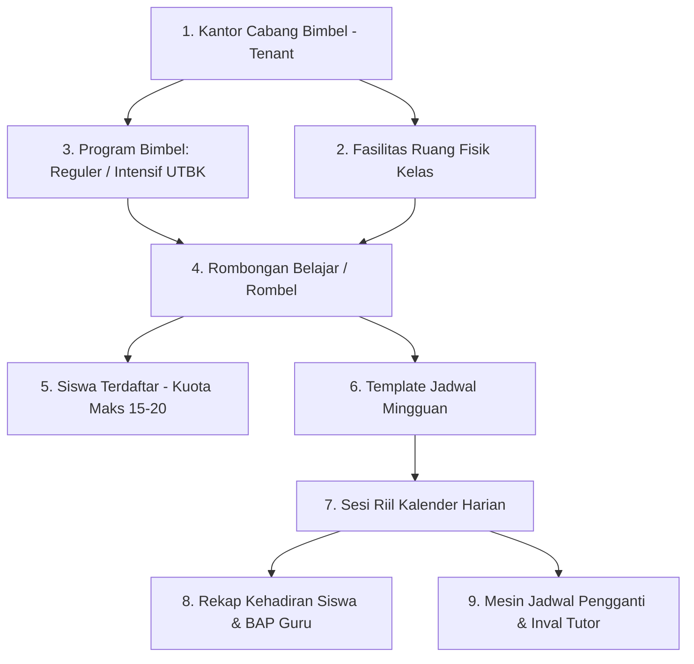
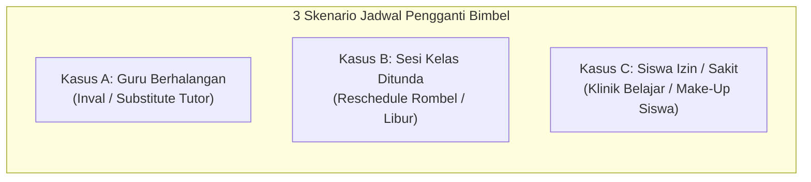
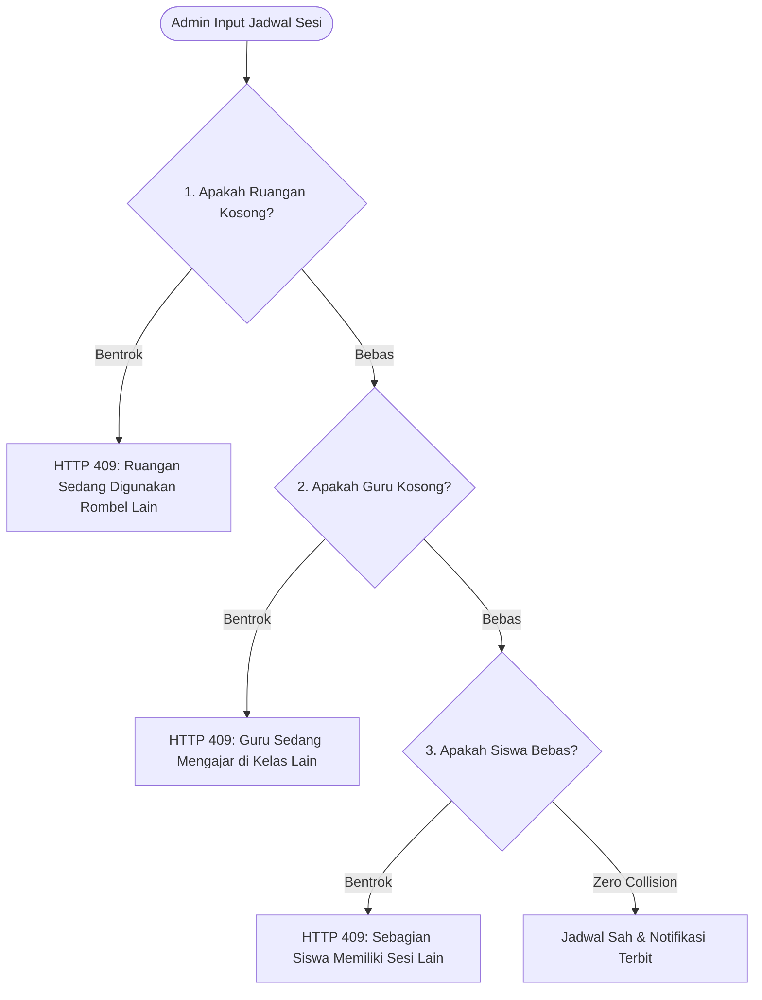
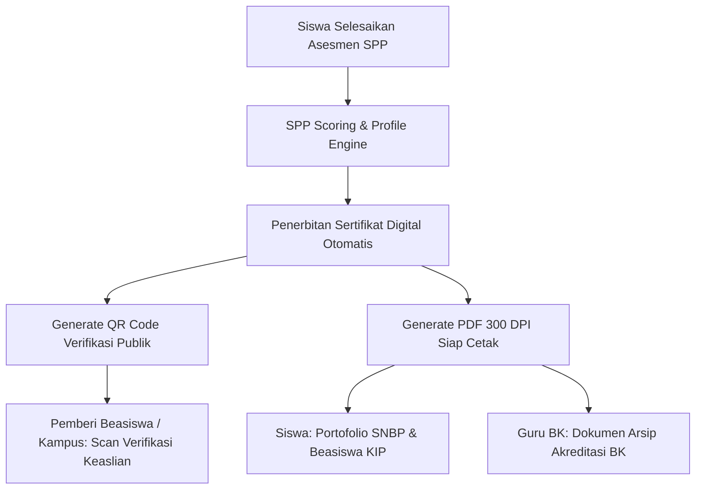

# ANALISIS MENDALAM OPERASIONAL KELAS OFFLINE, REKAP KEHADIRAN & SERTIFIKAT SPP
**Platform:** EduPath SaaS (Adaptive Learning & CBT IRT Platform)  
**Dokumen:** Blueprint Rekayasa Sistem Kelas Tatap Muka, Presensi, dan Sertifikasi  
**Versi:** 2.0.0 (Comprehensive Specification Edition)  
**Klasifikasi:** Dokumen Spesifikasi Rekayasa Sistem & Desain Operasional Cabang  

---

## 1. PENDAHULUAN & ARSITEKTUR KELAS BELAJAR OFFLINE (BIMBEL TATAP MUKA)

Operasional bimbingan belajar tatap muka (*offline learning*) pada kantor cabang fisik EduPath beroperasi dengan struktur organisasi multi-tenant yang terikat ketat pada wilayah kantor cabang (`tenant_id`).

### 1.1 Lima Pilar Fisik Operasional Kelas Offline



1. **Kantor Cabang Bimbel (`tenants`)**: Badan pengelola fisik yang memiliki izin operasional wilayah, gedung belajar, dan menaungi administrator cabang, tutor lokal, serta siswa binaan cabang.
2. **Ruang Fisik Kelas (`class_rooms`)**: Inventaris ruang belajar (misal: Ruang 101 Einstein, Ruang 102 Newton, Lab CBT Komputer) yang memiliki batasan kapasitas kursi maksimal.
3. **Program Bimbingan (`plans`)**: Paket layanan tatap muka (misal: *Reguler 12 SMA 3x Pertemuan/Minggu*, *Super Intensif SNBT Karantina*, *Kedinasan*).
4. **Rombongan Belajar / Rombel (`classes`)**: Kelompok belajar siswa yang diikat oleh kesamaan program, jenjang, kurikulum, dan ruangan utama.
5. **Penugasan Siswa (`class_students`)**: Pemetaan siswa ke dalam rombel dengan batasan kuota ketat (maksimal 15–20 siswa per kelas) guna menjaga rasio interaksi guru-siswa yang optimal.

---

## 2. MANAJEMEN PENJADWALAN & SKENARIO JADWAL PENGGANTI (RESCHEDULE & INVAL)

### 2.1 Pembedaan Level Jadwal: Template Mingguan vs Sesi Riil
Dalam operasional bimbingan belajar modern, terdapat pemisahan tegas antara:
1. **Master Jadwal Mingguan (*Class Schedules Template*)**: Aturan pola berulang per minggu (misal: Kelas 12-IPA-A belajar setiap hari **Senin & Kamis, pukul 14.00–16.00 WIB**).
2. **Sesi Riil Kalender (*Class Sessions Instance*)**: Instansiasi tanggal nyata dari template mingguan (misal: *Sesi Pertemuan Ke-12, Senin 26 Oktober 2026, Ruang 101, Pengampu: Kak Andi, S.Pd.*).

Pada level sesi riil inilah seluruh dinamika operasional bimbingan belajar tatap muka terjadi: keterlambatan, izin sakit, pemadaman listrik, dan **jadwal pengganti**.

---

### 2.2 Analisis Tiga Skenario Jadwal Pengganti (*Reschedule & Substitute Scenarios*)



#### A. Skenario 1: Guru Pengampu Berhalangan Hadir (Inval / Guru Pengganti)
* **Kondisi**: Guru utama (*Primary Tutor*) berhalangan hadir secara mendadak (sakit, tugas dinas, kemalangan) pada sesi yang sudah dijadwalkan.
* **Tanggung Jawab Eksekusi**: **Admin Cabang (`admin`)**.
* **Alur Bisnis Proses**:
  1. Guru mengajukan izin absen di sistem melalui portal pendidik sebelum batas waktu minimal (misal: minimal 4 jam sebelum kelas dimulai).
  2. Sistem EduPath secara otomatis menampilkan **Rekomendasi Tutor Pengganti (*Eligible Inval Tutors*)** berdasarkan 3 parameter:
     * Menguasai mata pelajaran / subtes yang sama (misal: Penalaran Matematika).
     * Terikat pada kantor cabang yang sama (`tenant_id`).
     * **Tidak memiliki jadwal mengajar lain** pada slot waktu sesi tersebut (*Zero-Conflict*).
  3. Admin Cabang memilih dan menunjuk Guru Pengganti (*Inval Tutor*).
  4. Sesi tetap berjalan di ruangan fisik dan jam yang sama. Hak pengisian presensi siswa dan Berita Acara Pengajaran (BAP) dialihkan ke Guru Pengganti.
  5. **Konsekuensi Payroll/Honor**: Sistem secara otomatis mengalokasikan kredit honor mengajar sesi tersebut ke Guru Pengganti dan memotong beban jam mengajar guru utama.

#### B. Skenario 2: Sesi Rombel Ditunda / Diliburkan (Reschedule Sesi Rombel)
* **Kondisi**: Hari libur nasional yang tidak terjadwal, renovasi mendadak gedung cabang, pemadaman listrik PLN, bencana alam, atau seluruh siswa rombel memiliki ujian sekolah serentak.
* **Tanggung Jawab Eksekusi**: **Admin Cabang (`admin`)**.
* **Alur Bisnis Proses**:
  1. Admin Cabang menandai sesi riil pada tanggal tersebut menjadi `cancelled_by_branch`.
  2. Admin Cabang membuat **Sesi Pengganti Rombel (*Rescheduled Session*)**:
     * Menentukan tanggal pengganti (misal: hari Minggu atau akhir pekan).
     * Menentukan jam mulai dan jam selesai pengganti.
     * Memilih ruangan fisik yang tersedia.
  3. **Mesin Deteksi Benturan Jadwal (*Conflict Detection Engine*)**:
     Sistem mengeksekusi kueri validasi:
     $$\text{Benturan} = (\text{RuanganTerisi}) \lor (\text{GuruSibuk}) \lor (\text{SiswaAdaJadwalLain})$$
     Jika ada benturan jadwal, sistem menolak penyimpanan dan meminta Admin Cabang memilih slot waktu alternatif.
  4. Sistem mengirimkan pengumuman otomatis ke dashboard siswa dan notifikasi siaran via **Telegram Bot EduPath** ke akun Telegram orang tua/siswa (`parent_telegram_id` / `telegram_chat_id`).

#### C. Skenario 3: Siswa Izin / Sakit (Sesi Klinik Belajar Pengganti Siswa)
* **Kondisi**: Sesi kelas reguler tetap berjalan normal bersama teman-temannya, namun ada 1–2 siswa yang berhalangan hadir karena sakit atau kegiatan ekstrakurikuler sekolah.
* **Mekanisme Solusi Bimbel EduPath**:
  1. **Rotasi Kelas Paralel (*Cross-Rombel Guest*)**: Siswa dimasukkan sementara sebagai siswa tamu (*guest student*) pada rombel paralel lain di cabang yang mempelajari bab materi yang sama pada hari lain minggu tersebut.
  2. **Klinik Konsultasi 1-on-1 (*Make-Up Clinic Session*)**: Siswa melakukan booking sesi bimbingan klinik bersama tutor piket cabang selama 30–45 menit untuk membahas rangkuman konsep materi yang tertinggal dan latihan soal mandiri.

---

### 2.3 Algoritma Mesin Deteksi Benturan Jadwal (Conflict Detection Engine)



Kueri backend MariaDB pencegah benturan ruangan dan guru:
```sql
SELECT id, room_id, teacher_id FROM class_sessions
WHERE session_date = :target_date
  AND status NOT IN ('cancelled', 'rescheduled')
  AND (
    (room_id = :room_id) OR (teacher_id = :teacher_id)
  )
  AND (
    (start_time < :end_time AND end_time > :start_time)
  )
  AND id != :current_session_id
LIMIT 1;
```

---

## 3. MESIN REKAPITULASI KEHADIRAN (ATTENDANCE ANALYTICS & PAYROLL ENGINE)

### 3.1 Rekap Kehadiran Siswa (Student Attendance Recapitulation)
Kehadiran siswa merupakan indikator vital penentu kelulusan seleksi PTN dan syarat klaim garansi bimbingan belajar.

#### A. Status Presensi Siswa:
* **Hadir ($H$)**: Siswa berada di ruang kelas fisik tepat waktu saat sesi dimulai.
* **Terlambat ($T$)**: Siswa hadir dengan keterlambatan lebih dari 15 menit (tercatat menit keterlambatan).
* **Sakit ($S$)**: Siswa tidak hadir dengan menyertakan surat dokter / pemberitahuan resmi orang tua.
* **Izin ($I$)**: Siswa mengajukan izin resmi sebelumnya (kegiatan sekolah/keluarga).
* **Alpa ($A$)**: Siswa tidak hadir tanpa keterangan (*unexcused absence*).

#### B. Formula Persentase Kehadiran:
$$\text{Persentase Kehadiran Siswa} = \left( \frac{\text{Jumlah Sesi Hadir} + (0.5 \times \text{Jumlah Terlambat})}{\text{Total Sesi Kelas yang Telah Berjalan}} \right) \times 100\%$$

#### C. Sistem Peringatan Dini (*Early Warning System / EWS*):
1. **Level 1 (Waspada)**: Kehadiran siswa berada di antara $75\% - 80\%$. Muncul badge kuning pada dashboard siswa dan notifikasi pengingat ke siswa.
2. **Level 2 (Bahaya)**: Kehadiran siswa $< 75\%$ atau berturut-turut $3\times$ Alpa tanpa keterangan.
   * Muncul alarm merah pada dashboard Admin Cabang.
   * Sistem secara otomatis mengirimkan pesan laporan peringatan dini via **Telegram Bot EduPath** ke akun Telegram Orang Tua Siswa (`parent_telegram_id`) dan akun Guru BK Sekolah.
   * **Sanksi Akademik**: Siswa dibekukan sementara dari hak klaim beasiswa bimbel / garansi uang kembali (*Tuition Guarantee Revocation*).

#### D. Laporan Rekapitulasi Multidimensi yang Dihasilkan:
* **Rekap per Rombel**: Menilai tingkat kedisiplinan dan kekompakan angkatan belajar.
* **Rekap per Mata Pelajaran / Subtes**: Mendeteksi jika ada subtes tertentu (misal: *Penalaran Kuantitatif*) yang sering dihindari atau diboloskan oleh siswa.
* **Buku Rapor Kehadiran Bulanan**: Berkas rekapitulasi kehadiran per siswa yang diekspor ke PDF/Excel untuk dibagikan saat pembagian rapor periodik kepada wali murid.

---

### 3.2 Rekap Kehadiran Guru & Jam Mengajar Riil (Tutor Timesheet & Payroll)

#### A. Komponen Validasi Mengajar Guru:
* **Presensi Masuk & Keluar Sesi (*Check-in / Check-out*)**: Guru memencet tombol mulai sesi di kelas.
* **Berita Acara Pengajaran (BAP) Wajib**: Sebelum sesi dapat ditutup (*Mark as Completed*), guru **wajib mengisi BAP**:
  * Judul Bab & Sub-materi yang berhasil dituntaskan.
  * Halaman buku modul / bank soal yang dibahas.
  * Catatan evaluasi daya serap kelas (misal: *"Sebagian besar siswa kesulitan pada turunan fungsi trigonometri"*).
* **Pencatatan Presensi Siswa**: Guru harus menandai status kehadiran seluruh siswa di rombel sebelum sistem memperbolehkan penutupan sesi.

#### B. Perhitungan Honor / Payroll Mengajar Cabang:
Sistem menghitung honor tutor bulanan secara otomatis berdasarkan log sesi yang berstatus `completed`:

$$\text{Total Honor} = \sum (\text{Jam Sesi Reguler} \times R_{\text{reguler}}) + \sum (\text{Jam Sesi Inval} \times R_{\text{inval}}) + \sum (\text{Jam Sesi Klinik} \times R_{\text{klinik}}) - \text{Denda Keterlambatan}$$

* **Keterangan**:
  * $R_{\text{reguler}}$: Tarif per jam sesi mengajar kelas rutin yang dijadwalkan.
  * $R_{\text{inval}}$: Tarif insentif khusus bagi guru pengganti yang bersedia mengajar mendadak ($R_{\text{inval}} \ge R_{\text{reguler}}$).
  * $R_{\text{klinik}}$: Tarif sesi klinik bimbingan konsultasi personal 1-on-1.
  * Rekapitulasi timesheet ini dapat diunduh oleh Admin Cabang setiap tanggal cut-off payroll (misal: tanggal 25 setiap bulan).

---

## 4. SISTEM PENERBITAN & VERIFIKASI SERTIFIKAT SPP (STUDENT POTENTIAL PATH)

### 4.1 Nilai Strategis Sertifikat SPP
Sertifikat SPP (*Student Potential Path Certificate*) bukan sekadar piagam kelulusan, melainkan **Kredensial Hasil Uji Diagnostik Resmi (*Verifiable Diagnostic Credential*)** yang memetakan kepribadian psikometrik, modalitas belajar, dan proyeksi rumpun program studi siswa.



* **Manfaat bagi Siswa (B2C)**: Lampiran bukti kepribadian akademik resmi saat mendaftar beasiswa kuliah (KIP-K / swasta) dan dokumen pendukung portofolio peminatan SNBP (Seleksi Nasional Berdasarkan Prestasi).
* **Manfaat bagi Sekolah & Guru BK (B2B2C)**: Memenuhi instrumen akreditasi sekolah terkait pelaksanaan asesmen diagnostik minat bakat dan bimbingan karier angkatan secara terukur.
* **Branding & Akuisisi Siswa**: Memperluas reputasi platform EduPath sebagai lembaga bimbingan belajar yang berbasis sains data (*Data-Driven EdTech*).

---

### 4.2 Struktur & Komponen Anatomi Sertifikat SPP

Sertifikat SPP dicetak dalam orientasi *Landscape*, resolusi tinggi standar percetakan (300 DPI) dengan elemen desain berstandar dokumen resmi:

```
+--------------------------------------------------------------------------------------------------+
|  [LOGO EDUPATH]                             EDUPATH INDONESIA                   [LOGO CABANG/TENANT] |
|                                   SERTIFIKAT ASESMEN POTENSI SISWA                                |
|                                Nomor Sertifikat: CERT-SPP-2026-BDG-98421                          |
|                                                                                                  |
|  Diberikan dengan bangga kepada:                                                                 |
|                                    MUHAMMAD RIZKY PRATAMA                                        |
|                          NISN: 0067829102  •  SMA Negeri 1 Bandung                                |
|                                                                                                  |
|  Telah berhasil menuntaskan Uji Diagnostik Student Potential Path (SPP) komprehensif 4 dimensi   |
|  pada tanggal 26 Oktober 2026 dengan rincian profil psikometrik sebagai berikut:                |
|                                                                                                  |
|  +-----------------------------+-----------------------------+--------------------------------+  |
|  | KODE TIPE MINAT HOLLAND     | MODALITAS GAYA BELAJAR      | REKOMENDASI RUMPUN KEILMUAN    |  |
|  | RIASEC: I - S - E           | VISUAL - ANALYTICAL         | 1. Sains Data & Informatika    |  |
|  | (Investigative-Social-Enter)| Daya Serap Optimal:         | 2. Teknik Elektro / Robotika   |  |
|  | Kekuatan: Analisis Logis,   | Stimulus Visual Diagram &   | 3. Kedokteran & Bioteknologi   |  |
|  | Penelitian Ilmiah, Problem  | Studi Kasus Terstruktur     | Passing Grade Match: 92.4%     |  |
|  | Solving Konseptual          |                             |                                |  |
|  +-----------------------------+-----------------------------+--------------------------------+  |
|                                                                                                  |
|  [QR CODE OTENTIKASI]                                          Bandung, 26 Oktober 2026          |
|  Scan untuk Verifikasi Keabsahan                              Direktur Akademik EduPath          |
|  https://edupath.co.id/verify-cert                                                               |
|  Hash: a9b3e...f81                                            (Tanda Tangan & Cap Digital Resmi) |
+--------------------------------------------------------------------------------------------------+
```

---

### 4.3 Siklus Hidup & Mesin Otentikasi Sertifikat (Verification Engine)

1. **Pemicu Penerbitan (*Trigger*)**:
   * Siswa menuntaskan seluruh butir pertanyaan asesmen SPP pada endpoint `api/spp.php?action=submit_attempt`.
   * Layanan [`SPPService.php`](file:///c:/Users/yanay/OneDrive/Documents/YANA/ELYANA.BIZ.ID/7%20BIMBEL/BIMBEL%20V1/api/spp_service.php) memvalidasi status skoring menjadi `SCORED` dan status kualitas asesmen `ACCEPTABLE`.
2. **Penerbitan Nomor Seri Unik**:
   Nomor sertifikat disusun dengan format terstruktur:
   $$\text{CERT-SPP}-\{\text{TAHUN}\}-\{\text{SLUG\_CABANG}\}-\{\text{SEQUENCE\_HASH}\}$$
3. **Penyusunan Hash Kriptografis (SHA-256)**:
   Mencegah manipulasi data hasil asesmen:
   $$\text{Hash} = \text{SHA256}(\text{StudentID} + \text{AttemptID} + \text{RIASEC\_Code} + \text{IssueDate} + \text{SECRET\_KEY})$$
4. **Verifikasi Publik (*Zero-Login Public Verification*)**:
   Siapapun (Orang Tua, Guru BK, Panitia Beasiswa, Pihak Kampus) dapat memindai QR Code di sertifikat atau mengakses URL:
   `https://edupath.co.id/verify-cert?id=UUID`
   Sistem memvalidasi keaslian hash dan menampilkan ringkasan profil siswa tanpa mewajibkan pengguna login ke sistem.

---

## 5. SPESIFIKASI SKEMA BASIS DATA TERPADU (DDL SQL)

Berikut skema tabel terpadu untuk **Manajemen Kelas Offline, Rekap Kehadiran, dan Sertifikat SPP**:

```sql
-- ========================================================
-- 1. MODUL RUANG & KELAS OFFLINE
-- ========================================================

CREATE TABLE `class_rooms` (
  `id` varchar(36) NOT NULL,
  `tenant_id` varchar(36) NOT NULL,
  `name` varchar(100) NOT NULL,
  `capacity` int(11) NOT NULL DEFAULT 15,
  `is_active` tinyint(1) DEFAULT 1,
  PRIMARY KEY (`id`),
  KEY `cr_tenant_fk` (`tenant_id`),
  CONSTRAINT `cr_tenant_fk` FOREIGN KEY (`tenant_id`) REFERENCES `tenants` (`id`) ON DELETE CASCADE
) ENGINE=InnoDB DEFAULT CHARSET=utf8mb4;

CREATE TABLE `classes` (
  `id` varchar(36) NOT NULL,
  `tenant_id` varchar(36) NOT NULL,
  `name` varchar(150) NOT NULL,
  `academic_year` varchar(20) NOT NULL,
  `default_room_id` varchar(36) DEFAULT NULL,
  `max_capacity` int(11) NOT NULL DEFAULT 15,
  `status` enum('draft','active','graduated','archived') DEFAULT 'active',
  `created_at` timestamp NULL DEFAULT CURRENT_TIMESTAMP,
  PRIMARY KEY (`id`),
  KEY `cls_tenant_fk` (`tenant_id`),
  CONSTRAINT `cls_tenant_fk` FOREIGN KEY (`tenant_id`) REFERENCES `tenants` (`id`) ON DELETE CASCADE,
  CONSTRAINT `cls_room_fk` FOREIGN KEY (`default_room_id`) REFERENCES `class_rooms` (`id`) ON DELETE SET NULL
) ENGINE=InnoDB DEFAULT CHARSET=utf8mb4;

CREATE TABLE `class_students` (
  `id` varchar(36) NOT NULL,
  `class_id` varchar(36) NOT NULL,
  `student_id` varchar(36) NOT NULL,
  `joined_at` datetime NOT NULL DEFAULT CURRENT_TIMESTAMP,
  `status` enum('active','transferred','dropped') DEFAULT 'active',
  PRIMARY KEY (`id`),
  UNIQUE KEY `uq_class_student` (`class_id`, `student_id`),
  KEY `cs_student_fk` (`student_id`),
  CONSTRAINT `cs_class_fk` FOREIGN KEY (`class_id`) REFERENCES `classes` (`id`) ON DELETE CASCADE,
  CONSTRAINT `cs_student_fk` FOREIGN KEY (`student_id`) REFERENCES `students` (`id`) ON DELETE CASCADE
) ENGINE=InnoDB DEFAULT CHARSET=utf8mb4;

CREATE TABLE `class_schedules` (
  `id` varchar(36) NOT NULL,
  `class_id` varchar(36) NOT NULL,
  `day_of_week` tinyint(4) NOT NULL,
  `start_time` time NOT NULL,
  `end_time` time NOT NULL,
  `subject` varchar(100) NOT NULL,
  `room_id` varchar(36) NOT NULL,
  `primary_teacher_id` varchar(36) NOT NULL,
  PRIMARY KEY (`id`),
  KEY `csch_class_fk` (`class_id`),
  KEY `csch_room_fk` (`room_id`),
  CONSTRAINT `csch_class_fk` FOREIGN KEY (`class_id`) REFERENCES `classes` (`id`) ON DELETE CASCADE,
  CONSTRAINT `csch_room_fk` FOREIGN KEY (`room_id`) REFERENCES `class_rooms` (`id`)
) ENGINE=InnoDB DEFAULT CHARSET=utf8mb4;

-- ========================================================
-- 2. SESI KALENDER RIIL & PRESENSI BAP
-- ========================================================

CREATE TABLE `class_sessions` (
  `id` varchar(36) NOT NULL,
  `class_id` varchar(36) NOT NULL,
  `schedule_id` varchar(36) DEFAULT NULL,
  `session_date` date NOT NULL,
  `start_time` time NOT NULL,
  `end_time` time NOT NULL,
  `room_id` varchar(36) NOT NULL,
  `teacher_id` varchar(36) NOT NULL,
  `original_teacher_id` varchar(36) DEFAULT NULL,
  `session_type` enum('regular','rescheduled','inval','makeup_clinic') DEFAULT 'regular',
  `status` enum('scheduled','in_progress','completed','cancelled','rescheduled') DEFAULT 'scheduled',
  `reschedule_reason` text DEFAULT NULL,
  `rescheduled_to_session_id` varchar(36) DEFAULT NULL,
  `bap_notes` text DEFAULT NULL,
  `completed_at` datetime DEFAULT NULL,
  PRIMARY KEY (`id`),
  KEY `ses_class_date` (`class_id`, `session_date`),
  KEY `ses_room_time` (`room_id`, `session_date`, `start_time`),
  KEY `ses_teacher_time` (`teacher_id`, `session_date`, `start_time`),
  CONSTRAINT `ses_class_fk` FOREIGN KEY (`class_id`) REFERENCES `classes` (`id`) ON DELETE CASCADE,
  CONSTRAINT `ses_room_fk` FOREIGN KEY (`room_id`) REFERENCES `class_rooms` (`id`)
) ENGINE=InnoDB DEFAULT CHARSET=utf8mb4;

CREATE TABLE `session_attendances` (
  `id` varchar(36) NOT NULL,
  `session_id` varchar(36) NOT NULL,
  `student_id` varchar(36) NOT NULL,
  `attendance_status` enum('present','late','sick','permitted','absent') NOT NULL DEFAULT 'absent',
  `minutes_late` int(11) DEFAULT 0,
  `check_in_time` datetime DEFAULT NULL,
  `notes` varchar(255) DEFAULT NULL,
  PRIMARY KEY (`id`),
  UNIQUE KEY `uq_session_student` (`session_id`, `student_id`),
  KEY `att_student_fk` (`student_id`),
  CONSTRAINT `att_session_fk` FOREIGN KEY (`session_id`) REFERENCES `class_sessions` (`id`) ON DELETE CASCADE,
  CONSTRAINT `att_student_fk` FOREIGN KEY (`student_id`) REFERENCES `students` (`id`) ON DELETE CASCADE
) ENGINE=InnoDB DEFAULT CHARSET=utf8mb4;

-- ========================================================
-- 3. SERTIFIKAT SPP (STUDENT POTENTIAL PATH)
-- ========================================================

CREATE TABLE `spp_certificates` (
  `id` varchar(36) NOT NULL,
  `tenant_id` varchar(36) NOT NULL,
  `student_id` varchar(36) NOT NULL,
  `attempt_id` varchar(36) NOT NULL,
  `certificate_number` varchar(100) NOT NULL,
  `riasec_code` varchar(10) NOT NULL,
  `learning_style` varchar(50) NOT NULL,
  `top_recommendations` text DEFAULT NULL,
  `issue_date` date NOT NULL,
  `verification_hash` varchar(64) NOT NULL,
  `pdf_url` varchar(255) DEFAULT NULL,
  `created_at` timestamp NULL DEFAULT CURRENT_TIMESTAMP,
  PRIMARY KEY (`id`),
  UNIQUE KEY `uq_cert_number` (`certificate_number`),
  UNIQUE KEY `uq_cert_attempt` (`attempt_id`),
  KEY `cert_tenant_fk` (`tenant_id`),
  KEY `cert_student_fk` (`student_id`),
  CONSTRAINT `cert_tenant_fk` FOREIGN KEY (`tenant_id`) REFERENCES `tenants` (`id`) ON DELETE CASCADE,
  CONSTRAINT `cert_student_fk` FOREIGN KEY (`student_id`) REFERENCES `students` (`id`) ON DELETE CASCADE,
  CONSTRAINT `cert_attempt_fk` FOREIGN KEY (`attempt_id`) REFERENCES `spp_attempts` (`id`) ON DELETE CASCADE
) ENGINE=InnoDB DEFAULT CHARSET=utf8mb4;
```

---

## 6. MATRIKS WEWENANG OPERASIONAL LINTAS ROLE

| Fitur / Modul | Superadmin | Admin Cabang | Guru / Tutor | Guru BK | Siswa |
|:---|:---:|:---:|:---:|:---:|:---:|
| **Manajemen Ruangan & Rombel** | Audit Global | **Full CRUD Cabang** | ❌ | ❌ | ❌ |
| **Assign Siswa ke Kelas** | ❌ | **Eksekutor Penuh** | ❌ | ❌ | ❌ |
| **Pengaturan Jadwal Mingguan** | ❌ | **Eksekutor Penuh** | Menerima | ❌ | Menerima |
| **Penunjukan Guru Inval / Reschedule**| ❌ | **Pengambil Keputusan** | Pengaju Izin / Penerima Inval | ❌ | Penerima Notifikasi |
| **Input Presensi Siswa & BAP Sesi** | ❌ | Verifikasi Cabang | **Eksekutor di Kelas** | ❌ | ❌ |
| **Monitoring EWS Kehadiran Siswa (<75%)**| ❌ | **Follow-up & Telegram Wali**| Monitoring | Monitoring Siswa Binaan | Melihat Peringatan |
| **Rekap Timesheet Payroll Guru** | Kebijakan Tarif | **Kalkulasi & Ekspor** | Rekap Jam Mengajar | ❌ | ❌ |
| **Penerbitan Sertifikat SPP Digital**| Standar Mutu | Verifikasi Cabang | ❌ | **Download Rombel BK**| **Download Mandiri** |
| **Verifikasi Publik QR Sertifikat** | ✅ Publik | ✅ Publik | ✅ Publik | ✅ Publik | ✅ Publik |

---
*Dokumen blueprint ini mengintegrasikan seluruh operasional fisik bimbingan belajar cabang, presensi berstandar payroll, dan sertifikasi digital terverifikasi di ekosistem EduPath.*
