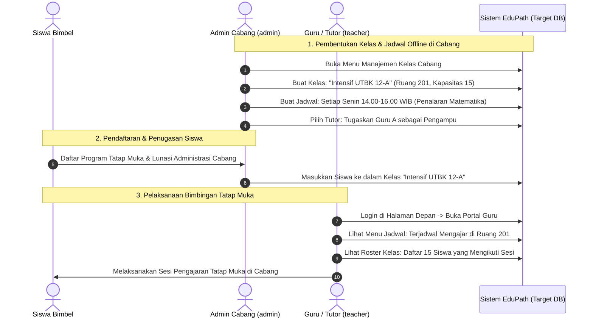
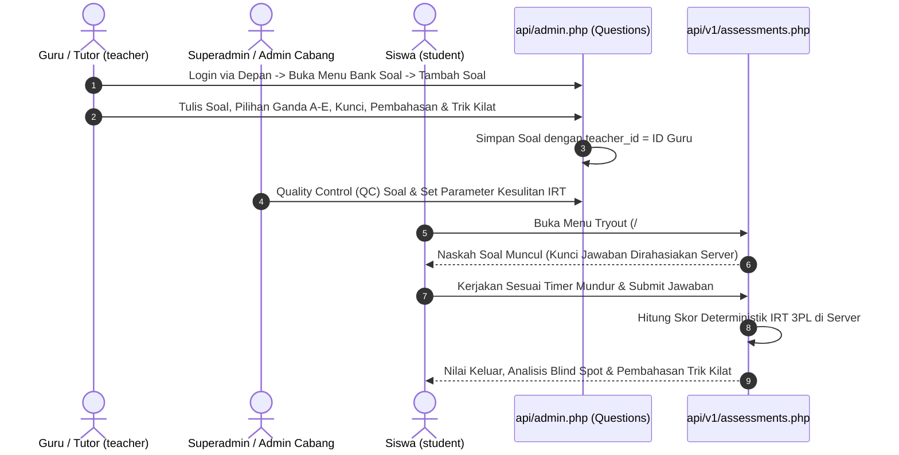
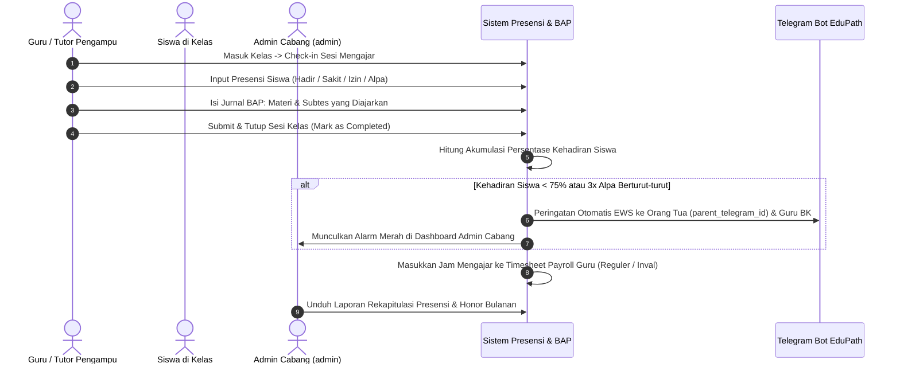
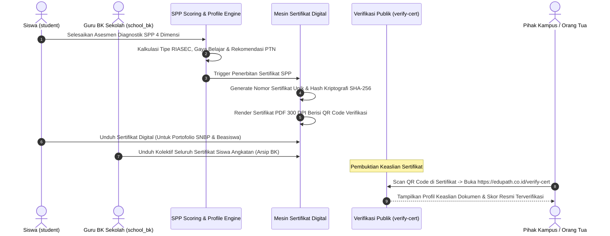

# PANDUAN LENGKAP FUNGSI DAN BISNIS PROSES SELURUH ROLE AKSES EDUPATH
**Platform:** EduPath SaaS (Adaptive Learning & CBT IRT Platform)  
**Dokumen:** Buku Panduan Operasional, Realitas Sistem & Target Proses Bisnis  
**Versi:** 2.1.0 (Audited & Forensic-Aligned Edition)  
**Status Audit:** Telah Diverifikasi Terhadap Kode Sumber (`src/`, `api/`, dan Skema Basis Data)  

---

## 1. PENDAHULUAN & ARSITEKTUR GERBANG MASUK (AUTHENTICATION GATEWAY)

### 1.1 Aturan Baku Pintu Masuk Autentikasi (Authentication Boundary)
Berdasarkan implementasi kode pada backend [`api/admin.php`](file:///c:/Users/yanay/OneDrive/Documents/YANA/ELYANA.BIZ.ID/7%20BIMBEL/BIMBEL%20V1/api/admin.php) (baris 321–328) dan frontend [`src/views/AdminPanel.vue`](file:///c:/Users/yanay/OneDrive/Documents/YANA/ELYANA.BIZ.ID/7%20BIMBEL/BIMBEL%20V1/src/views/AdminPanel.vue) (baris 38–42 & 126), sistem EduPath menerapkan pemisahan gerbang login yang tegas:

> [!IMPORTANT]
> **ATURAN MUTLAK GERBANG MASUK SISTEM**:
> 1. **Portal Administrator (`/#/admin`)**:  
>    **HANYA** dapat diakses oleh akun dengan peran **`superadmin`** (Super Administrator) dan **`admin`** (Admin Cabang / Tenant).  
>    Jika akun `teacher` (Guru), `school_bk` (Guru BK), `student` (Siswa), atau `affiliate` (Mitra Afiliasi) mencoba login di `/#/admin`, backend [`api/admin.php`](file:///c:/Users/yanay/OneDrive/Documents/YANA/ELYANA.BIZ.ID/7%20BIMBEL/BIMBEL%20V1/api/admin.php) secara otomatis menolak dengan status **HTTP 403 Forbidden**:  
>    *"Akses khusus Administrator & Superadmin. Silakan masuk melalui form login siswa di halaman depan."*
> 2. **Portal Utama / Halaman Depan (`/#/`)**:  
>    Merupakan pintu masuk utama bagi **Siswa (`student`)**, **Guru / Tutor (`teacher`)**, dan **Mitra Afiliasi (`affiliate`)** melalui modal login di header depan ([`src/App.vue`](file:///c:/Users/yanay/OneDrive/Documents/YANA/ELYANA.BIZ.ID/7%20BIMBEL/BIMBEL%20V1/src/App.vue) memanggil [`api/auth.php`](file:///c:/Users/yanay/OneDrive/Documents/YANA/ELYANA.BIZ.ID/7%20BIMBEL/BIMBEL%20V1/api/auth.php)).  
>    Setelah Guru berhasil login di halaman depan, sistem mengenali perannya (`role: teacher`) dan memunculkan tombol navigasi khusus: **"Buka Portal Guru / Bank Soal"** untuk mengakses antarmuka akademik.
> 3. **Portal B2B2C Sekolah (`/#/school`)**:  
>    Merupakan pintu masuk khusus bagi **Koordinator Guru BK & Kepala Sekolah Mitra (`school_bk`)** melalui [`src/views/SchoolDashboard.vue`](file:///c:/Users/yanay/OneDrive/Documents/YANA/ELYANA.BIZ.ID/7%20BIMBEL/BIMBEL%20V1/src/views/SchoolDashboard.vue) yang memanggil [`api/school.php`](file:///c:/Users/yanay/OneDrive/Documents/YANA/ELYANA.BIZ.ID/7%20BIMBEL/BIMBEL%20V1/api/school.php).

---

## 2. MATRIKS PERAN & STATUS IMPLEMENTASI FITUR (REALITAS VS TARGET)

Dokumen ini membedakan secara transparan antara:
* **[BERJALAN]**: Fitur sudah terhubung penuh antara antarmuka UI dan backend API/basis data.
* **[GAP / BELUM BEKERJA]**: Fitur telah dirancang / ada kerangka di UI atau backend, namun secara fungsional belum selesai atau masih dibatasi oleh kode (misal terkunci `v-if` atau endpoint belum lengkap).
* **[DUMMY / MOCKUP]**: Tampilan UI menggunakan data contoh lokal karena tabel relasi di basis data belum dibangun.

### 2.1 Ringkasan Gerbang & Tanggung Jawab 6 Peran

| No | Peran | Kode Role | Pintu Masuk Resmi | Tanggung Jawab Utama | Basis Data Induk |
|:---:|:---|:---:|:---|:---|:---|
| **1** | **Superadmin** | `superadmin` | `/#/admin` (Tab Superadmin) | Tata Kelola Platform Global, Master Tenant, Paket Global, Approval Payout | `admins` + `user_roles` |
| **2** | **Admin Cabang** | `admin` | `/#/admin` (Tenant-Scoped) | Operasional Kantor Cabang, Sekolah Mitra, **Pengaturan Jadwal & Kelas Offline** | `admins` + `tenants` |
| **3** | **Guru / Tutor** | `teacher` | **`/#/` (Modal Login Depan)** $\rightarrow$ Tombol Portal Guru | Penyusunan Bank Soal Mandiri, Mengajar Siswa, Evaluasi Blind Spot | `admins` + `user_roles` |
| **4** | **Sekolah & Guru BK** | `school_bk` | `/#/school` | Pemetaan Minat Bakat RIASEC Angkatan, Roster Siswa Sekolah, Sebar QR Code | `schools` + `users` |
| **5** | **Siswa / Student** | `student` | `/#/` & `/#/tryout` | Tes SPP, Simulasi CBT IRT 3PL, Latihan Soal, Pembelian Paket Pro | `students` + `subscriptions` |
| **6** | **Mitra Afiliasi** | `affiliate` | `affiliate.html` / `/#/` | Penyebaran Link Referral, Pemantauan Komisi, Pengajuan Pencairan Dana | `affiliates` + `commissions` |

---

### 2.2 Matriks Komparatif Fitur & Status Kesiapan Teknis

| Fitur / Modul Sistem | Superadmin | Admin Cabang | Guru / Tutor | Guru BK | Siswa | Status Implementasi Nyata |
|:---|:---:|:---:|:---:|:---:|:---:|:---:|
| **Dashboard Metrik Global** | ✅ | ❌ | ❌ | ❌ | ❌ | **[BERJALAN]** Real-time dari database |
| **Dashboard Omzet Cabang** | ✅ | ✅ | ❌ | ❌ | ❌ | **[BERJALAN]** Terisolasi per tenant |
| **Master Cabang (`tenants`)** | ✅ | ❌ | ❌ | ❌ | ❌ | **[BERJALAN]** Tambah/Nonaktifkan cabang |
| **Sekolah Mitra (`schools`)** | ✅ | ✅ Cabangnya | ❌ | ❌ Profil Saja | ❌ | **[BERJALAN]** Terhubung ke `school_bk` |
| **Bank Soal & Penilaian IRT** | ✅ QC Global | ✅ Cabang | ✅ Soal Sendiri | ❌ | ❌ Mengerjakan | **[BERJALAN]** Guru bisa buat/edit soal |
| **Pembuatan Materi Belajar Baru** | ✅ | ✅ | ⚠️ **TERKUNCI** | ❌ | ❌ | ⚠️ **[GAP]** Tombol dikunci `v-if="!isTeacher"` |
| **Upload Dokumen Materi (PDF)** | ⚠️ | ⚠️ | ⚠️ **BELUM AKTIF** | ❌ | ❌ | ⚠️ **[GAP]** Endpoint upload belum ada di backend |
| **Pembagian Kelas Siswa Offline** | ❌ | ⚠️ **PENGELOLA** | ❌ Menerima | ❌ | ❌ | ⚠️ **[GAP]** Tabel `classes` belum ada di DB |
| **Pengaturan Jadwal Belajar Offline**| ❌ | ⚠️ **PENGELOLA** | ⚠️ Lihat Jadwal | ❌ | ⚠️ Lihat Jadwal | ⚠️ **[MOCKUP]** Data di `teacher_hub` masih dummy |
| **Roster Siswa Sekolah & Ekspor CSV**| ✅ | ✅ | ❌ | ✅ Satu Sekolah | ❌ | **[BERJALAN]** Download CSV/Excel aktif |
| **Asesmen Minat Bakat RIASEC** | ✅ | ✅ | ❌ | ✅ Satu Sekolah | ✅ Kerjakan SPP | **[BERJALAN]** Analisis 6 dimensi John Holland |
| **CBT Tryout Simulasi UTBK BPPP**| ❌ Pratinjau | ❌ Pratinjau | ❌ Pratinjau | ❌ | ✅ Ujian Resmi | **[BERJALAN]** Antarmuka CBT & IRT Server |
| **Checkout Midtrans & Komisi** | ✅ Audit | ✅ Cabang | ❌ | ❌ | ✅ Beli Paket | **[BERJALAN]** Webhook 20%/10% atomik |
| **Approval Payout Afiliasi** | ✅ Eksekusi | ❌ Baca Saja | ❌ | ❌ | ❌ | **[BERJALAN]** Verifikasi rekening & approve |

---

## 3. PANDUAN PERAN 1: SUPERADMIN (TATA KELOLA PLATFORM GLOBAL)

### 3.1 Identitas & Tanggung Jawab Peran
* **Peran**: Pemilik Platform / *System Administrator Pusat*.
* **Tanggung Jawab Utama**: Menjamin kelancaran platform multi-tenant, mengelola entitas cabang bimbel, menerbitkan paket langganan global, mengawasi rekonsiliasi transaksi pembayaran Midtrans, dan menyetujui pencairan komisi afiliasi.
* **Pintu Masuk**: Rute khusus `/#/admin` (Kredensial demo UAT: `superadmin@uat.edupath.local` / `EduPathSuperAdmin01!2026`).

### 3.2 Modul yang Beroperasi Penuh
1. **Overview & Metrik Nasional**: Menampilkan total siswa seluruh cabang, siswa aktif, total butir soal, dan total omzet nasional.
2. **Master Cabang Bimbel (`branches`)**: Menambah entitas tenant/cabang baru, menyunting data legalitas cabang, serta mengaktifkan/menonaktifkan cabang.
3. **Katalog Paket Belajar & Entitlements (`packages`)**: Mengatur nama paket (`Pejuang PTN`, `Mandiri`, `Elite`), harga nominal, potongan harga diskon, masa aktif hari, serta kumpulan izin akses fitur (*Entitlements*).
4. **Transaksi Finansial (`transactions`)**: Rekonsiliasi transaksi pesanan dari Midtrans Snap (status: `settlement`, `pending`, `expire`).
5. **Afiliasi & Approval Payout (`affiliates`)**: Memverifikasi nomor rekening bank mitra dan melakukan persetujuan (*Approve*) atau penolakan (*Reject*) terhadap pengajuan pencairan dana komisi.
6. **Manajemen Staf Internal (`staff`)**: Mendaftarkan akun Admin Cabang (`admin`) dan Guru (`teacher`), mereset kata sandi staf, serta mengalokasikan staf ke cabang tertentu.
7. **Backup & Restore Basis Data (`backup_restore`)**: Mengunduh dump arsip SQL basis data dan memulihkan data saat terjadi gangguan darurat (*Disaster Recovery*).

---

## 4. PANDUAN PERAN 2: ADMIN CABANG (OPERASIONAL KANTOR WILAYAH)

### 4.1 Identitas & Tanggung Jawab Peran
* **Peran**: Kepala Operasional Cabang Bimbel / Administrator Wilayah.
* **Tanggung Jawab Utama**: Mengelola operasional harian bimbingan belajar pada kantor cabang yang dipimpinnya, membina sekolah mitra lokal, memverifikasi pembayaran siswa tunai di kasir cabang, **mengatur kelas belajar offline**, dan **menjadwalkan jam mengajar guru offline**.
* **Pintu Masuk**: Rute `/#/admin` (Kredensial demo UAT: `admin@uat.edupath.local` / `EduPathAdmin01!2026`, terikat ke `tenant_id` cabang).

### 4.2 Siapa yang Mengatur Jadwal Belajar Siswa Offline & Pembagian Kelas?
> [!IMPORTANT]
> **JAWABAN ARSITEKTUR & PROSES BISNIS BIMBEL**:
> Yang mengatur jadwal belajar siswa offline dan menugaskan siswa ke kelas adalah **ADMIN CABANG (`admin`)** (dibantu Koordinator Akademik Cabang).
> * **Alasan Bisnis**: Ruang fisik kelas, kapasitas meja/kursi, jam operasional gedung, dan ketersediaan tutor tatap muka berada di bawah wewenang kantor cabang fisik masing-masing, bukan kantor pusat.
> * **Alur Kerja Operasional**:
>   1. Siswa mendaftar program bimbingan tatap muka di cabang.
>   2. **Admin Cabang membuat entitas Rombel/Kelas**: Menentukan nama kelas (misal: *"Kelas Intensif UTBK 12-A"*), ruangan (misal: *"Ruang 201"*), dan daya tampung (misal: 15 siswa).
>   3. **Admin Cabang menugaskan Siswa ke Kelas (*Assign Student to Class*)**: Memasukkan siswa yang telah melunasi administrasi ke daftar rombel kelas tersebut.
>   4. **Admin Cabang mengatur Jadwal Belajar Offline**: Menetapkan hari (Senin/Rabu/Jumat), jam belajar (14.00–16.00 WIB), mata pelajaran (Penalaran Matematika), dan **menugaskan Guru/Tutor** yang mengajar di kelas tersebut.
>   5. **Guru / Tutor**: Melihat jadwal kelas yang ditugaskan kepadanya di portal pengajar dan mengajar siswa yang ada di daftar rombel.

### 4.3 Status Kesiapan Fitur Kelas & Jadwal Offline Saat Ini
* **Fakta Kode & Skema Basis Data Saat Ini**:
  * Di basis data eksisting ([`schema_dump.json`](file:///c:/Users/yanay/OneDrive/Documents/YANA/ELYANA.BIZ.ID/7%20BIMBEL/BIMBEL%20V1/schema_dump.json) & [`api/database.sql`](file:///c:/Users/yanay/OneDrive/Documents/YANA/ELYANA.BIZ.ID/7%20BIMBEL/BIMBEL%20V1/api/database.sql)), **BELUM TERSEDIA** tabel `classes` (kelas offline) maupun `class_schedules` (jadwal mengajar).
  * Di antarmuka [`AdminPanel.vue`](file:///c:/Users/yanay/OneDrive/Documents/YANA/ELYANA.BIZ.ID/7%20BIMBEL/BIMBEL%20V1/src/views/AdminPanel.vue) bagian `teacher_hub`, data jadwal mengajar (`teacherSchedule`) dan penugasan siswa saat ini masih berupa **DATA DUMMY / MOCKUP STATIK** (dengan catatan di kode: *"Data dummy jadwal — idealnya dari API admin/teacher-schedule endpoint"*).
* **Solusi & Target Pengembangan**:
  * Perlu penambahan tabel `classes` (`id`, `tenant_id`, `name`, `room`, `capacity`), `class_students` (`class_id`, `student_id`), dan `schedules` (`class_id`, `teacher_id`, `day`, `time_start`, `time_end`) pada API `admin.php` agar Admin Cabang dapat melakukan penugasan kelas dan jadwal secara dinamis dari sistem.

---

## 5. PANDUAN PERAN 3: GURU / TUTOR (KONTRIBUTOR AKADEMIK)

### 5.1 Identitas, Pintu Masuk, dan Rute Autentikasi
* **Peran**: Pendidik / Tutor Pengajar / Penulis Soal.
* **Pintu Masuk Resmi Sesuai Kode**:
  * Guru **TIDAK BISA** login langsung melalui `/#/admin` (jika mencoba login di sana, akan ditolak HTTP 403 oleh `admin.php`).
  * Guru **WAJIB** masuk melalui **Form Login di Halaman Depan (`/#/`)** menggunakan akun Guru yang didaftarkan oleh Admin Cabang / Superadmin.
  * Setelah berhasil login di halaman depan, profil pengguna menampilkan badge *"Akun Pendidik / Guru (Akses Penuh)"* dan menyediakan tombol aksi: **"Buka Portal Guru / Bank Soal"** yang mengarahkan ke antarmuka kerja pendidik.

---

### 5.2 Rincian Fitur Guru: Realitas Kode vs Kondisi Seharusnya

#### A. Bank Soal Saya (`questions`) — **[BERJALAN SEPENUHNYA]**
* **Kondisi Nyata Saat Ini**: Fitur ini sudah berjalan dengan baik.
* **Fungsi yang Dapat Dilakukan Guru**:
  * Menulis butir soal baru: Memilih Subtes (Penalaran Umum, Pengetahuan Kuantitatif, Literasi, Penalaran Matematika), Bab, dan Sub-materi.
  * Memasukkan narasi pertanyaan teks kaya, formula matematika LaTeX, opsi jawaban A–E, dan kunci jawaban resmi.
  * Menyusun penjelasan konsep (*Explanation*) dan "Trik Kilat EduPath".
  * Menetapkan tingkat kesulitan (*Easy, Medium, Hard, HOTS*) dan dimensi kognitif Bloom (C1–C6).
  * **Kepemilikan Butir Soal**: Soal yang dibuat otomatis tersimpan dengan `teacher_id = id_guru` dan `teacher_name = nama_guru`. Guru dapat menyunting dan menghapus butir soal buatannya sendiri.

#### B. Pembuatan & Unggah Materi Belajar (`materials`) — **[GAP: BELUM BEKERJA UNTUK GURU]**
* **Kondisi Nyata Saat Ini di Kode**:
  1. Di antarmuka [`src/views/AdminPanel.vue`](file:///c:/Users/yanay/OneDrive/Documents/YANA/ELYANA.BIZ.ID/7%20BIMBEL/BIMBEL%20V1/src/views/AdminPanel.vue) baris 975:
     ```html
     <button v-if="!isTeacher" @click="openMaterialModal()" ...>
       <i class="ph-bold ph-plus"></i> Tambah Materi
     </button>
     ```
     Tombol **"Tambah Materi" secara eksplisit dikunci dengan `v-if="!isTeacher"`**. Akibatnya, saat Guru membuka tab Materi, Guru **TIDAK DAPAT** membuat materi baru.
  2. Fungsi pengunggahan berkas dokumen PDF (`upload_material_file`) di backend [`api/admin.php`](file:///c:/Users/yanay/OneDrive/Documents/YANA/ELYANA.BIZ.ID/7%20BIMBEL/BIMBEL%20V1/api/admin.php) belum diimplementasikan, sehingga unggah modul PDF belum berfungsi.
  3. Guru saat ini hanya bisa melihat daftar materi yang sudah diterbitkan sebelumnya oleh Superadmin/Admin.
* **Kondisi Seharusnya Sesuai Perancangan (*Target State*)**:
  * Guru **harus memiliki tombol Tambah Materi** untuk mengunggah ringkasan materi, tautan video YouTube penjelasan konsep, dan dokumen PDF modul belajar untuk mata pelajaran yang diampunya, dengan otomatis tercatat `teacher_id = id_guru`.

#### C. Siswa & Jadwal Saya (`teacher_hub`) — **[STATUS: MOCKUP DATA / BELUM TERINTEGRASI]**
* **Kondisi Nyata Saat Ini di Kode**:
  * Tampilan daftar siswa binaan dan jadwal mengajar di tab `teacher_hub` masih menggunakan data contoh statis (dummy).
  * Belum ada fitur absensi kehadiran siswa kelas offline secara real-time.
* **Kondisi Seharusnya Sesuai Perancangan (*Target State*)**:
  * Guru membuka tab Jadwal untuk melihat kelas offline mana saja yang harus ia ajar minggu ini sesuai jadwal yang telah diatur oleh Admin Cabang.
  * Guru dapat melihat daftar nama siswa yang terdaftar di kelas tersebut untuk mencatat presensi dan mengevaluasi hasil tryout mereka.

---

## 6. PANDUAN PERAN 4: SEKOLAH & GURU BK (MITRA B2B2C)

### 6.1 Identitas & Tanggung Jawab Peran
* **Peran**: Koordinator Guru Bimbingan Konseling (BK) / Kepala Sekolah Mitra.
* **Pintu Masuk**: Portal mandiri di rute `/#/school` didukung oleh [`src/views/SchoolDashboard.vue`](file:///c:/Users/yanay/OneDrive/Documents/YANA/ELYANA.BIZ.ID/7%20BIMBEL/BIMBEL%20V1/src/views/SchoolDashboard.vue) dan backend [`api/school.php`](file:///c:/Users/yanay/OneDrive/Documents/YANA/ELYANA.BIZ.ID/7%20BIMBEL/BIMBEL%20V1/api/school.php).

### 6.2 Modul yang Beroperasi Penuh
1. **Dashboard Agregat Angkatan (`analytics`)**: Menampilkan total siswa sekolah yang terdata, proporsi akun gratis vs akun berbayar, jumlah siswa yang sudah ikut tryout, dan nilai rata-rata CBT angkatan.
2. **Peminatan Psikometrik RIASEC (`riasec`)**: Memetakan sebaran bakat dan tipe kepribadian 6 dimensi John Holland (*Realistic, Investigative, Artistic, Social, Enterprising, Conventional*) dari asesmen SPP siswa satu sekolah.
3. **Peta Target Kampus PTN (`ptn`)**: Menampilkan daftar 5 Universitas dan Program Studi teratas yang paling diminati oleh siswa sekolah tersebut untuk mencegah benturan pilihan jurusan di internal sekolah.
4. **Roster Siswa & Ekspor Data (`students`)**: Menampilkan tabel lengkap nama siswa, kontak telepon / Telegram, target PTN, kode RIASEC, dan skor tryout terakhir. Dilengkapi fitur **Ekspor CSV/Excel** yang berjalan aktif untuk bahan laporan bimbingan konseling ke pimpinan sekolah.
5. **Sebar Tautan & Generator QR Code (`broadcast`)**: Menerbitkan link pendaftaran unik berparameter `?school=NamaSekolah#/spp` dan gambar QR Code siap cetak untuk dibagikan saat sosialisasi bimbingan karier di sekolah. Siswa yang memindai QR Code ini otomatis terhubung ke akun Guru BK terkait.

---

## 7. PANDUAN PERAN 5: SISWA / STUDENT (KONSUMEN AKHIR & PEMBELAJAR)

### 7.1 Identitas & Pintu Masuk
* **Peran**: Siswa SMA / Pejuang Gap Year / Peserta Bimbingan Belajar.
* **Pintu Masuk**: Halaman utama `/#/` dan antarmuka ujian di `/#/tryout`.

### 7.2 Fitur yang Beroperasi Penuh
1. **Simulator Peluang PTN AI & Mini Quiz HOTS**: Simulator interaktif di landing page untuk memprediksi probabilitas diterima di program studi impian berdasarkan skor tryout dan komitmen belajar.
2. **Asesmen Diagnostik SPP (Student Potential Path)**: Kuisioner diagnostik untuk memetakan kepribadian RIASEC, gaya belajar (*visual, auditory, kinesthetic*), dan subtes prioritas pembenahan nilai.
3. **Dashboard Gamifikasi**: Memantau kedisiplinan belajar harian (*streak counter*), perolehan koin EduCoins, dan pemantau sisa poin menuju passing grade PTN.
4. **Modul Belajar Adaptif 7 Subtes UTBK**: Membaca materi belajar terstruktur per subtes (Penalaran Umum, Pengetahuan Kuantitatif, Literasi Bahasa Indonesia, Literasi Bahasa Inggris, Penalaran Matematika). Akun Gratis dibatasi tanda gembok, Akun Pro terbuka penuh.
5. **Ujian CBT Berstandar UTBK-SNBT BPPP (`/#/tryout`)**: Antarmuka simulasi ujian resmi dengan daftar nomor soal, status ragu-ragu, pengatur ukuran huruf ($A-$, $A$, $A+$), hitung mundur waktu ujian, serta penilaian deterministik berbasis **Item Response Theory (IRT 3PL)** di server backend.
6. **Checkout Pembelian Paket Pro**: Pembayaran paket belajar berbayar melalui Midtrans Snap (QRIS, VA Bank) dengan aktivasi seketika (*instant entitlement activation*) via webhook.

---

## 8. PANDUAN PERAN 6: MITRA AFILIASI (DISTRIBUSI ORGANIK)

### 8.1 Identitas & Pintu Masuk
* **Peran**: Agen Pemasaran / Alumni / Duta EduPath.
* **Pintu Masuk**: Halaman khusus `affiliate.html`, `affiliate_dashboard.html`, atau via form login halaman depan.

### 8.2 Fitur yang Beroperasi Penuh
1. **Generator Link & Kode Referral**: Menghasilkan tautan promosi `?ref=KODEUNIK` dan tombol salin link cepat.
2. **Mesin Komisi Bertingkat Otomatis**:
   * Komisi **20%** untuk transaksi pembelian paket pertama kali oleh siswa yang dirujuk.
   * Komisi **10%** untuk transaksi pembelian perpanjangan (*repeat order*).
   * Perhitungan dijalankan secara atomik di backend saat webhook pembayaran Midtrans diterima.
3. **Pengajuan Pencairan Saldo (*Payout Request*)**: Mitra dapat mengajukan penarikan dana komisi jika saldo yang terkumpul telah mencapai batas minimal penarikan **Rp 50.000**, dengan menginput nomor rekening bank tujuan.
4. **Sistem Anti-Fraud**: Menolak secara otomatis pemberian komisi jika terdeteksi indikasi *self-referral* (akun pendaftar sama dengan akun pemilik kode referral).

---

## 9. SIKLUS OPERASIONAL BISNIS LINTAS PERAN (END-TO-END WORKFLOWS)

### 9.1 Siklus Pengaturan Kelas & Jadwal Belajar Offline Bimbel
Diagram ini merumuskan alur pembagian kelas offline yang seharusnya dijalankan oleh kantor cabang bimbel:



---

### 9.2 Siklus Penulisan Soal Ujian oleh Guru & Ujian Siswa



---

### 9.3 Siklus Rekap Kehadiran Siswa & Validasi BAP Payroll Guru



---

### 9.4 Siklus Penerbitan & Verifikasi Sertifikat SPP (Student Potential Path)



---

## 10. DAFTAR RENCANA PERBAIKAN FITUR GURU, KELAS & SERTIFIKASI (ACTION PLAN / BACKLOG)

Agar platform EduPath bekerja 100% sesuai perancangan operasional bimbel yang ideal, berikut adalah daftar perbaikan teknis yang harus dieksekusi oleh tim pengembang:

1. **Buka Tombol Tambah Materi untuk Peran Guru**:
   * Di file [`src/views/AdminPanel.vue`](file:///c:/Users/yanay/OneDrive/Documents/YANA/ELYANA.BIZ.ID/7%20BIMBEL/BIMBEL%20V1/src/views/AdminPanel.vue) baris 975, ubah `v-if="!isTeacher"` menjadi `v-if="true"` atau beri akses agar peran `teacher` dapat memicu `openMaterialModal()`.
2. **Implementasikan Endpoint Upload Berkas Materi di Backend**:
   * Menambahkan *action handler* `upload_material_file` pada [`api/admin.php`](file:///c:/Users/yanay/OneDrive/Documents/YANA/ELYANA.BIZ.ID/7%20BIMBEL/BIMBEL%20V1/api/admin.php) dengan validasi tipe berkas (PDF, DOCX) dan penyimpanan aman di direktori publik server.
3. **Pembangunan Modul Manajemen Kelas & Jadwal Offline (*Class Management Engine*)**:
   * Membuat tabel skema basis data: `classes` (kelola rombel per cabang), `class_students` (penugasan siswa ke kelas oleh Admin Cabang), dan `class_schedules` (jadwal mengajar dan alokasi guru pengampu).
   * Menghubungkan antarmuka `teacher_hub` di frontend dengan endpoint dinamis kelas dan jadwal, menggantikan data mockup statis yang ada saat ini.
4. **Pembangunan Modul Presensi & Rekap Kehadiran (Attendance & Payroll Engine)**:
   * Menambahkan tabel `class_sessions` dan `session_attendances`.
   * Membangun antarmuka presensi digital bagi Guru di dalam kelas, rekapitulasi kehadiran siswa dengan sistem peringatan dini (*Early Warning System < 75%*), serta laporan *timesheet* honor mengajar per cabang.
5. **Pembangunan Generator & Halaman Verifikasi Sertifikat SPP**:
   * Menambahkan tabel `spp_certificates`.
   * Membangun generator PDF otomatis beresolusi tinggi (300 DPI) yang memuat grafik radar RIASEC, gaya belajar, dan QR Code verifikasi publik.
   * Menyediakan rute verifikasi publik `/#/verify-cert` yang dapat diakses siapa saja tanpa perlu login.

---
*Dokumen panduan ini telah diperbarui sesuai kondisi riil kode sumber dan arsitektur target bimbingan belajar EduPath.*
