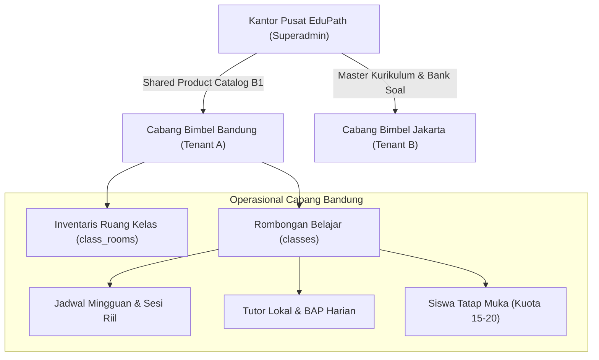
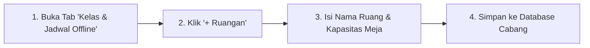
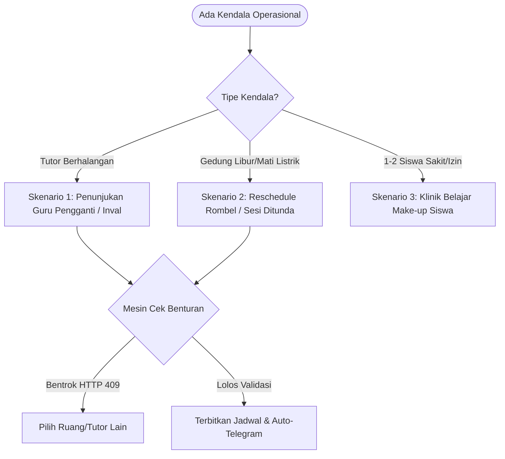
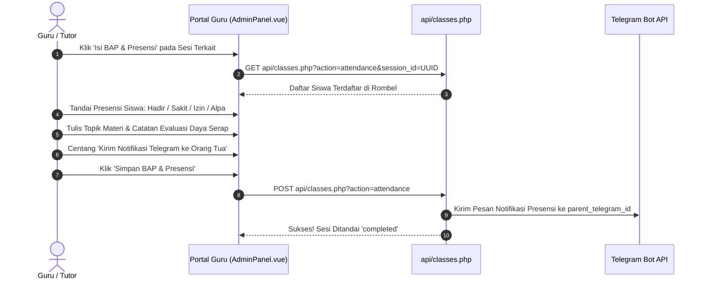
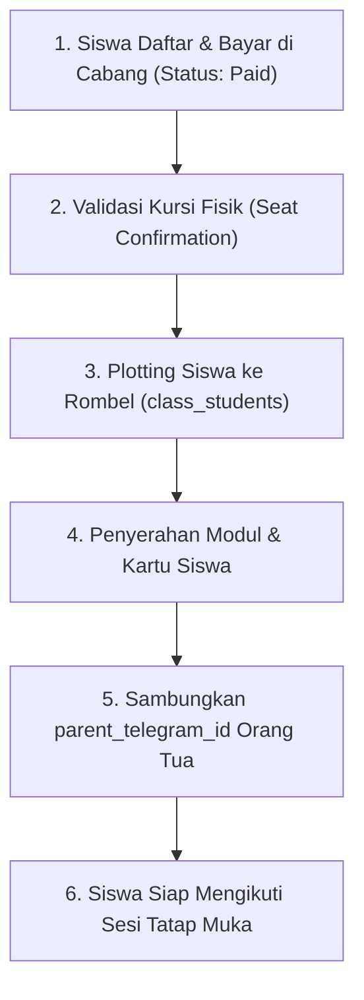

# BUKU PANDUAN STANDAR OPERASIONAL PROSEDUR (SOP) BIMBEL OFFLINE LINTAS PERAN
**Platform:** EduPath SaaS (Adaptive Learning & Hybrid Offline Bimbel Enterprise)  
**Dokumen:** Panduan Operasional Lengkap Bimbingan Belajar Tatap Muka Lintas Peran  
**Versi:** 3.0.0 (Forensic & Production Standard)  
**Status Implementasi:** Terverifikasi Penuh terhadap Kode Sumber (`api/classes.php`, `src/views/AdminPanel.vue`, `api/database/schema_offline_classes.sql`)  
**Target Pembaca:** Superadmin Pusat, Admin Cabang, Guru/Tutor Pengampu, Front Office/Operator, Siswa Tatap Muka, Orang Tua/Wali Murid, Guru Bimbingan Konseling (BK) Mitra  

---

## DAFTAR ISI

1. [PENDAHULUAN & ARSITEKTUR BIMBEL OFFLINE EDUPATH](#1-pendahuluan--arsitektur-bimbel-offline-edupath)
   - 1.1 [Prinsip Arsitektur Terpadu (Unified Academic & Offline Hybrid)](#11-prinsip-arsitektur-terpadu-unified-academic--offline-hybrid)
   - 1.2 [Lima Pilar Fisik Operasional Cabang](#12-lima-pilar-fisik-operasional-cabang)
   - 1.3 [Peta Gerbang Masuk & Hak Akses (RBAC Boundary)](#13-peta-gerbang-masuk--hak-akses-rbac-boundary)
2. [PANDUAN PERAN 1: SUPERADMIN (MANAJEMEN PUSAT / HEADQUARTERS)](#2-panduan-peran-1-superadmin-manajemen-pusat--headquarters)
   - 2.1 [Profil & Tanggung Jawab Utama](#21-profil--tanggung-jawab-utama)
   - 2.2 [Tata Kelola Master Cabang (Tenants)](#22-tata-kelola-master-cabang-tenants)
   - 2.3 [Pengelolaan Master Katalog Produk Offline (Shared Product Catalog - B1)](#23-pengelolaan-master-katalog-produk-offline-shared-product-catalog---b1)
   - 2.4 [Kebijakan Pembaruan Cohort Terpusat (Cohort Renewal Policy - B4)](#24-kebijakan-pembaruan-cohort-terpusat-cohort-renewal-policy---b4)
   - 2.5 [Audit Operasional & Monitoring Metrik Nasional](#25-audit-operasional--monitoring-metrik-nasional)
3. [PANDUAN PERAN 2: ADMIN CABANG (BRANCH OPERATIONAL HEAD)](#3-panduan-peran-2-admin-cabang-branch-operational-head)
   - 3.1 [Profil Peran & Pintu Masuk Resmi](#31-profil-peran--pintu-masuk-resmi)
   - 3.2 [SOP Manajemen Ruang Belajar Fisik (`class_rooms`)](#32-sop-manajemen-ruang-belajar-fisik-class_rooms)
   - 3.3 [SOP Pembentukan Rombongan Belajar / Rombel (`classes`)](#33-sop-pembentukan-rombongan-belajar--rombel-classes)
   - 3.4 [SOP Alokasi & Penugasan Siswa ke Rombel (`class_students`)](#34-sop-alokasi--penugasan-siswa-ke-rombel-class_students)
   - 3.5 [SOP Template Jadwal Mingguan & Generator Sesi Riil (`generate_sessions`)](#35-sop-template-jadwal-mingguan--generator-sesi-riil-generate_sessions)
   - 3.6 [SOP Penanganan Benturan & Jadwal Pengganti (Conflict Detection Engine)](#36-sop-penanganan-benturan--jadwal-pengganti-conflict-detection-engine)
   - 3.7 [SOP Persetujuan Pengajuan Kelas Pengganti / Make-Up Class (`approve_makeup_request`)](#37-sop-persetujuan-pengajuan-kelas-pengganti--make-up-class-approve_makeup_request)
   - 3.8 [SOP Early Warning System (EWS) Absensi & Peringatan Telegram](#38-sop-early-warning-system-ews-absensi--peringatan-telegram)
   - 3.9 [SOP Rekapitulasi Presensi & Payroll Honor Tutor Bulanan](#39-sop-rekapitulasi-presensi--payroll-honor-tutor-bulanan)
4. [PANDUAN PERAN 3: OPERATOR CABANG / FRONT OFFICE (SCOPED OPERATOR - B3)](#4-panduan-peran-3-operator-cabang--front-office-scoped-operator---b3)
   - 4.1 [Profil Peran & Batasan Wewenang](#41-profil-peran--batasan-wewenang)
   - 4.2 [SOP Meja Depan: Konfirmasi Kedatangan & Validasi Kursi Fisik](#42-sop-meja-depan-konfirmasi-kedatangan--validasi-kursi-fisik)
   - 4.3 [SOP Penanganan Keterlambatan & Izin Mendadak Siswa](#43-sop-penanganan-keterlambatan--izin-mendadak-siswa)
   - 4.4 [SOP Pelayanan Dispensasi & Cetak Kartu Masuk Kelas](#44-sop-pelayanan-dispensasi--cetak-kartu-masuk-kelas)
5. [PANDUAN PERAN 4: GURU / TUTOR PENGAJAR CABANG (`teacher`)](#5-panduan-peran-4-guru--tutor-pengajar-cabang-teacher)
   - 5.1 [Profil Peran & Pintu Masuk Resmi (`/#/` -> Portal Guru)](#51-profil-peran--pintu-masuk-resmi---portal-guru)
   - 5.2 [SOP Pra-Kelas: Pengecekan Jadwal & Roster Siswa di `teacher_hub`](#52-sop-pra-kelas-pengecekan-jadwal--roster-siswa-di-teacher_hub)
   - 5.3 [SOP Saat Pembelajaran: Pelaksanaan Tatap Muka Berbasis Modul](#53-sop-saat-pembelajaran-pelaksanaan-tatap-muka-berbasis-modul)
   - 5.4 [SOP Pasca-Kelas: Pengisian Presensi Real-Time & Berita Acara Pengajaran (BAP Wajib)](#54-sop-pasca-kelas-pengisian-presensi-real-time--berita-acara-pengajaran-bap-wajib)
   - 5.5 [SOP Penugasan Guru Pengganti (Inval Tutor)](#55-sop-penugasan-guru-pengganti-inval-tutor)
   - 5.6 [SOP Pelaksanaan Klinik Belajar Personal 1-on-1](#56-sop-pelaksanaan-klinik-belajar-personal-1-on-1)
   - 5.7 [SOP Pengecekan Akumulasi Jam Mengajar Pribadi (Timesheet)](#57-sop-pengecekan-akumulasi-jam-mengajar-pribadi-timesheet)
6. [PANDUAN PERAN 5: SISWA BIMBEL TATAP MUKA (`student`)](#6-panduan-peran-5-siswa-bimbel-tatap-muka-student)
   - 6.1 [Profil Peran & Pintu Masuk Siswa](#61-profil-peran--pintu-masuk-siswa)
   - 6.2 [Tata Tertib & Hak Belajar Siswa Offline](#62-tata-tertib--hak-belajar-siswa-offline)
   - 6.3 [SOP Memeriksa Roster Rombel, Ruangan, & Tutor (`my_classes`, `my_sessions`)](#63-sop-memeriksa-roster-rombel-ruangan--tutor-my_classes-my_sessions)
   - 6.4 [SOP Memantau Riwayat Kehadiran Pribadi (`my_attendance`)](#64-sop-memantau-riwayat-kehadiran-pribadi-my_attendance)
   - 6.5 [SOP Pengajuan Izin/Sakit & Booking Make-Up Class (`makeup_requests`)](#65-sop-pengajuan-izinsakit--booking-make-up-class-makeup_requests)
   - 6.6 [SOP Perpanjangan Periode Belajar Cohort (`renew_enrollment`)](#66-sop-perpanjangan-periode-belajar-cohort-renew_enrollment)
   - 6.7 [SOP Mengikuti Simulasi Tryout CBT di Laboratorium Komputer Cabang](#67-sop-mengikuti-simulasi-tryout-cbt-di-laboratorium-komputer-cabang)
7. [PANDUAN PERAN 6: ORANG TUA / WALI SISWA (MONITORING & ALERTING)](#7-panduan-peran-6-orang-tua--wali-siswa-monitoring--alerting)
   - 7.1 [Peran Orang Tua dalam Ekosistem Bimbel Tatap Muka](#71-peran-orang-tua-dalam-ekosistem-bimbel-tatap-muka)
   - 7.2 [Panduan Registrasi Notifikasi Telegram EduPath Bot](#72-panduan-registrasi-notifikasi-telegram-edupath-bot)
   - 7.3 [Format Notifikasi Real-Time (Masuk, Terlambat, Alpa)](#73-format-notifikasi-real-time-masuk-terlambat-alpa)
   - 7.4 [Penanganan Peringatan Dini EWS (<75%) & Rapor Bulanan](#74-penanganan-peringatan-dini-ews-75--rapor-bulanan)
8. [PANDUAN PERAN 7: GURU BK & SEKOLAH MITRA CABANG (`school_bk`)](#8-panduan-peran-7-guru-bk--sekolah-mitra-cabang-school_bk)
   - 8.1 [Peran Sekolah Mitra dalam Model B2B2C](#81-peran-sekolah-mitra-dalam-model-b2b2c)
   - 8.2 [Pintu Masuk Portal BK (`/#/school`)](#82-pintu-masuk-portal-bk-school)
   - 8.3 [Pemantauan Roster Siswa Sekolah di Kelas Offline Cabang](#83-pemantauan-roster-siswa-sekolah-di-kelas-offline-cabang)
   - 8.4 [Pemanfaatan Rekap Minat Bakat SPP & Nilai Tryout untuk Peminatan SNBP](#84-pemanfaatan-rekap-minat-bakat-spp--nilai-tryout-untuk-peminatan-snbp)
9. [PROTOKOL STANDAR OPERASIONAL (END-TO-END BUSINESS CYCLES)](#9-protokol-standar-operasional-end-to-end-business-cycles)
   - 9.1 [Siklus Pendaftaran Siswa Baru s/d Plotting Rombel](#91-siklus-pendaftaran-siswa-baru-sd-plotting-rombel)
   - 9.2 [Siklus Harian Pembelajaran Tatap Muka (H-1 Jam s/d Kelas Usai)](#92-siklus-harian-pembelajaran-tatap-muka-h-1-jam-sd-kelas-usai)
   - 9.3 [Siklus Tiga Kasus Jadwal Pengganti (Inval, Reschedule Rombel, Make-Up Siswa)](#93-siklus-tiga-kasus-jadwal-pengganti-inval-reschedule-rombel-make-up-siswa)
   - 9.4 [Siklus Bulanan: Validasi BAP, Rekonsiliasi Payroll, & Rapor Wali Murid](#94-siklus-bulanan-validasi-bap-rekonsiliasi-payroll--rapor-wali-murid)
10. [MATRIKS RACI TANGGUNG JAWAB OPERASIONAL CABANG](#10-matriks-raci-tanggung-jawab-operasional-cabang)
11. [TROUBLESHOOTING & FAQ KENDALA OPERASIONAL LAPANGAN](#11-troubleshooting--faq-kendala-operasional-lapangan)

---

## 1. PENDAHULUAN & ARSITEKTUR BIMBEL OFFLINE EDUPATH

### 1.1 Prinsip Arsitektur Terpadu (Unified Academic & Offline Hybrid)
Platform EduPath menyatukan pembelajaran daring (*online*) dan bimbingan belajar tatap muka (*offline learning*) ke dalam **satu kesatuan engine**:
* **Satu Bank Soal Terpusat**: Soal kuis harian, asesmen diagnostik, dan TryOut CBT IRT 3PL yang dikerjakan di laboratorium komputer cabang menggunakan bank soal terpadu.
* **Satu Hak Akses (Entitlement Engine)**: Pembelian paket bimbingan belajar offline langsung membuka hak akses materi digital, kuis adaptif, dan simulasi CBT online tanpa pembuatan akun terpisah.
* **Isolasi Wilayah Berbasis Tenant (`tenant_id`)**: Setiap kantor cabang fisik beroperasi sebagai entitas mandiri dengan data inventaris ruang, rombel belajar, penugasan tutor, dan transaksi keuangan lokal yang terisolasi aman.



---

### 1.2 Lima Pilar Fisik Operasional Cabang
Operasional harian bimbingan belajar tatap muka EduPath ditopang oleh 5 pilar struktur data:
1. **Kantor Cabang Fisik (`tenants`)**: Gedung bimbingan belajar tempat terselenggaranya kegiatan belajar mengajar, dipimpin oleh Admin Cabang.
2. **Ruang Belajar Fisik (`class_rooms`)**: Inventaris ruang tatap muka (misal: *Ruang 101 Einstein*, *Ruang 102 Newton*, *Lab CBT Komputer*) dengan kapasitas fisik terukur (15–20 meja kursi).
3. **Program & Paket Layanan (`plans` / `class_offerings`)**: Paket bimbingan tatap muka resmi yang ditawarkan (misal: *Reguler 12 SMA SNBT 3x/Minggu*, *Super Intensif UTBK Karantina*, *Kedinasan*).
4. **Rombongan Belajar / Rombel (`classes`)**: Kelompok belajar siswa yang diikat oleh kesamaan program, jenjang studi, ruangan utama, dan tutor pengampu.
5. **Penugasan Siswa (`class_students`)**: Pemetaan siswa aktif ke dalam rombel dengan penegakan kuota ketat guna menjamin efektivitas rasio belajar pendidik-siswa.

---

### 1.3 Peta Gerbang Masuk & Hak Akses (RBAC Boundary)

| No | Peran Pengguna | Kode Role | Pintu Masuk Resmi | Modul Utama Terkait Bimbel Offline |
|:---:|:---|:---:|:---|:---|
| **1** | **Superadmin** | `superadmin` | `/#/admin` | Master Cabang, Shared Catalog B1, Kebijakan Renewal B4, Audit Transaksi Global |
| **2** | **Admin Cabang** | `admin` | `/#/admin` | Ruangan, Rombel, Jadwal Mingguan, Generator Sesi, Inval Tutor, EWS Presensi, Payroll |
| **3** | **Operator / Front Office**| `operator` | Portal Staf Cabang | Check-in Meja Depan, Validasi Kursi, Verifikasi Karcis Make-Up, Dispensasi Keterlambatan |
| **4** | **Guru / Tutor** | `teacher` | `/#/` (Modal Login Depan) $\rightarrow$ Tab `teacher_hub` | Jadwal Mengajar, Roster Kelas, Input Presensi, Jurnal BAP Wajib, Honor Mengajar |
| **5** | **Siswa Tatap Muka** | `student` | `/#/` & `/#/tryout` | Jadwal Sesi Saya, Rekap Presensi, Booking Klinik Make-Up, Perpanjangan Cohort, CBT Lab |
| **6** | **Orang Tua / Wali** | `parent` | Bot Telegram EduPath & WhatsApp | Notifikasi Presensi Real-Time, Alert EWS (<75%), Rapor Kehadiran Bulanan |
| **7** | **Guru BK Mitra** | `school_bk` | `/#/school` | Roster Siswa Sekolah di Cabang, Rapor SPP Minat Bakat, Proyeksi Kelulusan SNBP |

---

## 2. PANDUAN PERAN 1: SUPERADMIN (MANAJEMEN PUSAT / HEADQUARTERS)

### 2.1 Profil & Tanggung Jawab Utama
* **Identitas**: Administrator Sistem Terpusat / Tim Manajemen Pusat EduPath.
* **Tanggung Jawab**:
  1. Menerbitkan dan mengatur entitas cabang fisik baru (`tenants`).
  2. Mengelola Master Katalog Produk Terpusat (*Shared Product Catalog* - Keputusan Arsitektur B1).
  3. Menetapkan kebijakan pembaharuan cohort bimbingan (*Cohort Renewal Policy* - Keputusan Arsitektur B4).
  4. Mengawasi utilisasi ruang kelas nasional dan audit kepatuhan pengisian presensi di seluruh cabang.
* **Pintu Masuk**: `/#/admin` (Kredensial Superadmin Master).

---

### 2.2 Tata Kelola Master Cabang (Tenants)
1. **Mendaftarkan Cabang Baru**:
   - Buka menu **Cabang Bimbel (`branches`)** di antarmuka Admin Panel.
   - Klik tombol **+ Tambah Cabang**.
   - Masukkan informasi legalitas:
     - `Nama Cabang`: Misal "EduPath Cabang Bandung Dago".
     - `Slug Cabang`: Misal "bandung-dago" (wajib unik, digunakan untuk penomoran sertifikat resmi).
     - `Alamat Gedung Fisik`, `Kota`, `Provinsi`, dan `Nomor Telepon Kantor Cabang`.
   - Simpan entitas cabang. Sistem secara otomatis menyiapkan namespace multi-tenant untuk cabang tersebut.
2. **Menunjuk Admin Cabang**:
   - Buka menu **Staf & Pendidik (`staff`)**.
   - Daftarkan akun Administrator Cabang dengan menetapkan peran `admin` dan menghubungkannya ke `tenant_id` cabang baru tersebut.

---

### 2.3 Pengelolaan Master Katalog Produk Offline (Shared Product Catalog - B1)
Berdasarkan Keputusan Bisnis B1, seluruh paket bimbel offline didefinisikan secara terpusat:
1. Masuk ke menu **Paket Belajar (`packages`)**.
2. Klik tombol **+ Buat Paket Produk Baru**.
3. Tetapkan atribut paket:
   - `Program Akademik`: Pilih salah satu dari 5 program (TKA SD, TKA SMP, TKA SMA, SNPMB/UTBK, SNPMB Alumni).
   - `Mode Pelaksanaan`: Tetapkan `offline` atau `hybrid`.
   - `Harga Dasar (Base Price)`: Misal Rp 3.500.000 / Semester.
   - `Komponen Layanan`: Tetapkan jumlah total sesi tatap muka (misal 36 pertemuan), akses lab CBT, modul cetak, dan kuota klinik bimbingan privat 1-on-1 (misal 4 sesi per semester).
4. **Penyesuaian Harga Khusus Cabang (Tenant Override - AC-01 & AC-02)**:
   - Jika cabang memiliki perbedaan daya beli regional, Admin Cabang dapat mengajukan penyesuaian harga melalui mekanisme `tenant_product_overrides` tanpa merusak katalog master pusat.
   - Superadmin menyetujui override harga melalui audit trail resmi dengan mencatat otorisasi pimpinan pusat.

---

### 2.4 Kebijakan Pembaruan Cohort Terpusat (Cohort Renewal Policy - B4)
Mengacu pada Keputusan Arsitektur B4:
* Superadmin mengonfigurasi aturan perpanjangan program di `api/classes.php?action=renewal_policies`:
  1. `new_enrollment`: Siswa lama yang ingin melanjutkan bimbingan ke semester/tingkat berikutnya didaftarkan sebagai enrollment baru dengan kebebasan memilih rombel/cohort baru.
  2. `extend_existing`: Siswa memperpanjang rombel yang sama tanpa menimpa riwayat absensi periode sebelumnya.
  3. `allowed_cohort_change`: Menetapkan apakah siswa diizinkan berpindah cohort/rombel saat perpanjangan (misal dari kelas siang ke kelas sore).

---

### 2.5 Audit Operasional & Monitoring Metrik Nasional
* Superadmin memantau metrik operasional terpadu di dashboard **Overview**:
  - Total rombel offline aktif di seluruh Indonesia.
  - Rasio keterisian kapasitas ruang (*Room Utilization Rate*).
  - Skor rata-rata kehadiran nasional (Target Standar Operasional $\ge 88\%$).
  - Pelanggaran presensi: Cabang dengan tingkat keterlambatan guru di atas $15\%$ langsung masuk ke daftar audit manajemen pusat.

---

## 3. PANDUAN PERAN 2: ADMIN CABANG (BRANCH OPERATIONAL HEAD)

### 3.1 Profil Peran & Pintu Masuk Resmi
* **Identitas**: Kepala Operasional Bimbingan Belajar Cabang / Administrator Wilayah.
* **Ruang Lingkup**: Penuh atas satu wilayah kerja kantor cabang (`tenant_id`).
* **Pintu Masuk**: `/#/admin` (Login menggunakan akun Admin Cabang).
* **Menu Kerja Utama**: **Kelas & Jadwal Offline (`offline_classes`)** dan **Guru & Tutor Cabang (`staff`)**.

---

### 3.2 SOP Manajemen Ruang Belajar Fisik (`class_rooms`)
Sebelum rombel belajar dibentuk, Admin Cabang wajib mendaftarkan seluruh inventaris ruangan fisik gedung:



1. Buka tab **Kelas & Jadwal Offline** di Admin Panel.
2. Pada banner atas, klik tombol **+ Ruangan**.
3. Masukkan data ruangan:
   - `Nama Ruangan`: Misal *"Ruang 101 - Einstein"* atau *"Lab CBT Komputer Lt. 2"*.
   - `Kapasitas Maksimal`: Masukkan jumlah kursi riil (Standar EduPath: 15–20 siswa untuk kelas reguler, 8–10 siswa untuk kelas eksekutif).
4. Klik **Simpan Ruangan**.
5. *Catatan Pemeliharaan*: Jika suatu ruangan sedang dalam perbaikan fisik/renovasi, ubah statusnya menjadi `Nonaktif` agar mesin penjadwalan tidak mengalokasikan sesi ke ruangan tersebut.

---

### 3.3 SOP Pembentukan Rombongan Belajar / Rombel (`classes`)
1. Pada tab **Kelas & Jadwal Offline**, klik tombol **+ Buat Kelas Baru**.
2. Lengkapi formulir pembuatan rombel:
   - `Nama Kelas`: Misal *"12-IPA-Reguler-A"* atau *"Intensif UTBK Pejuang PTN Batch 1"*.
   - `Tahun Ajaran / Periode`: Misal *"2026/2027 Ganjil"*.
   - `Jenjang Pendidikan`: Pilih `SD`, `SMP`, `SMA`, atau `ALUMNI`.
   - `Ruang Utama (Default Room)`: Pilih salah satu ruangan aktif yang telah didaftarkan.
   - `Tutor Utama (Primary Teacher)`: Pilih tutor tetap yang bertanggung jawab mengawal rombel tersebut.
   - `Kapasitas Maksimal`: Masukkan kuota maksimal siswa (maksimal tidak boleh melampaui kapasitas fisik ruangan default).
3. Klik **Simpan Kelas**. Kelas baru akan muncul pada tabel daftar rombel.

---

### 3.4 SOP Alokasi & Penugasan Siswa ke Rombel (`class_students`)
Setelah kelas dibentuk dan siswa melunasi pembayaran pendaftaran paket tatap muka:
1. Temukan kelas target pada tabel rombel, klik tombol **Siswa (n)**.
2. Muncul modal **Manajemen Siswa Rombel**:
   - Bagian atas menampilkan daftar siswa yang sudah terdaftar di kelas beserta nomor telepon/Telegram orang tua.
   - Bagian bawah menampilkan formulir **+ Tambahkan Siswa Baru ke Kelas Ini**.
3. Pilih nama siswa dari dropdown siswa aktif cabang.
4. Klik **Tambahkan Siswa**.
5. **Guardrail Validasi Kapasitas**: Sistem menolak penambahan jika jumlah siswa sudah mencapai `max_capacity`. Jika kuota penuh, Admin Cabang harus membuka rombel paralel baru (*Paralel B*).

---

### 3.5 SOP Template Jadwal Mingguan & Generator Sesi Riil (`generate_sessions`)
EduPath membedakan antara pola berulang mingguan dengan sesi riil di kalender harian:

#### A. Membuat Master Pola Jadwal Mingguan:
1. Pada baris kelas di tabel rombel, klik tombol **Jadwal Rutin**.
2. Modal penjadwalan akan terbuka:
   - `Hari`: Pilih hari (Senin s/d Minggu).
   - `Jam Mulai & Jam Selesai`: Format 24 jam (misal 14:00 s/d 16:00 WIB).
   - `Ruangan`: Default ruang kelas (bisa disesuaikan jika hari tertentu menggunakan Lab Komputer).
   - `Tutor Pengajar`: Pilih guru pengampu subtes hari tersebut.
   - `Mata Pelajaran / Subtes`: Pilih (misal: *Penalaran Matematika*, *Literasi Bahasa Inggris*).
3. Klik **Simpan Slot Jadwal**. Buat slot untuk seluruh hari pertemuan dalam seminggu.

#### B. Menghasilkan Sesi Riil Kalender (*Generate Real Sessions*):
1. Di bagian bawah modal jadwal rutin, buka panel **Generate Sesi Pertemuan Riil**.
2. Masukkan parameter rentang waktu:
   - `Tanggal Mulai Semester`: Misal 10 Januari 2026.
   - `Tanggal Selesai Semester`: Misal 20 Mei 2026.
3. Klik tombol **Generate Sesi Kalender**.
4. Sistem mengeksekusi endpoint `POST api/classes.php?action=generate_sessions`:
   - Mesin secara otomatis menghitung seluruh tanggal yang cocok dengan hari pola mingguan.
   - Mesin melakukan *Conflict Checking* instan terhadap ketersediaan ruangan dan tutor.
   - Sesi-sesi riil diterbitkan ke database dengan status awal `scheduled`.

---

### 3.6 SOP Penanganan Benturan & Jadwal Pengganti (Conflict Detection Engine)
Admin Cabang bertanggung jawab mengelola dinamika harian kelas offline menggunakan 3 skenario:



#### Skenario 1: Penunjukan Guru Pengganti (Inval Tutor)
* **Kondisi**: Guru utama mendadak sakit atau tugas dinas.
* **Prosedur**:
  1. Buka sesi terkait pada tabel sesi harian cabang.
  2. Klik **Ganti Pengampu (Inval)**.
  3. Sistem menampilkan rekomendasi guru cabang yang menguasai subtes yang sama dan berstatus **bebas jadwal (*Zero Collision*)**.
  4. Pilih guru pengganti. Hak pengisian presensi dan BAP berpindah ke guru inval.
  5. Sistem otomatis mengalokasikan kredit honor mengajar sesi tersebut ke guru pengganti.

#### Skenario 2: Reschedule Sesi Rombel (Penundaan Kelas Bersama)
* **Kondisi**: Hari libur serentak, bencana, pemadaman listrik PLN.
* **Prosedur**:
  1. Ubah status sesi tanggal tersebut menjadi `cancelled_by_branch`.
  2. Buka menu **Buat Sesi Pengganti Rombel**.
  3. Masukkan tanggal baru, jam baru, dan ruangan.
  4. Mesin deteksi benturan mengeksekusi kueri pencegah tumpang tindih:
     $$\text{Collision} = (\text{RuanganTerpakai}) \lor (\text{TutorSibuk}) \lor (\text{SiswaAdaSesiLain})$$
  5. Jika valid, sesi tersimpan dan notifikasi perubahan jadwal otomatis terkirim via Telegram ke orang tua dan siswa.

---

### 3.7 SOP Persetujuan Pengajuan Kelas Pengganti / Make-Up Class (`approve_makeup_request`)
* **Kondisi**: Siswa berhalangan hadir pada sesi reguler karena sakit/izin resmi dan mengajukan hak klinik belajar pengganti.
* **Prosedur Admin Cabang**:
  1. Buka tab **Pengajuan Make-Up Siswa** (`api/classes.php?action=makeup_requests`).
  2. Periksa detail permohonan:
     - Nama siswa dan rombel asal.
     - Sesi yang ditinggalkan beserta alasan bukti surat izin.
     - Sisa kuota make-up siswa (Standar: Maksimal 2–3x per semester).
  3. Tentukan opsi solusi:
     - **Opsi A**: Gabung ke rombel paralel yang mempelajari subtes yang sama di hari lain.
     - **Opsi B**: Sesi Klinik Belajar Konsultasi 1-on-1 (30–45 menit) bersama tutor piket cabang.
  4. Klik **Setujui (Approve)** atau **Tolak (Reject)** disertai alasan resmi.

---

### 3.8 SOP Early Warning System (EWS) Absensi & Peringatan Telegram
Kehadiran tatap muka siswa dimonitor secara ketat melalui formula persentase kehadiran:
$$\text{Persentase Kehadiran} = \left( \frac{\text{Jumlah Sesi Hadir} + (0.5 \times \text{Jumlah Terlambat})}{\text{Total Sesi yang Berjalan}} \right) \times 100\%$$

1. Setiap kali guru menyimpan presensi, sistem mengevaluasi ambang batas EWS:
   * **Level 1 (Kuning - Waspada)**: Kehadiran siswa berada di rentang $75\% - 80\%$.
   * **Level 2 (Merah - Bahaya)**: Kehadiran $< 75\%$ atau siswa **3x berturut-turut Alpa**.
2. **Tindakan Admin Cabang**:
   - Periksa dashboard `ews_report` harian di Admin Panel.
   - Siswa berstatus merah akan otomatis memicu pesan peringatan bot Telegram ke akun orang tua (`parent_telegram_id`).
   - Admin Cabang wajib memanggil siswa untuk sesi konseling personal dan mengonfirmasi kondisi ke wali murid.
   - *Sanksi Akademik*: Siswa dengan kehadiran $< 75\%$ gugur hak klaim garansi kelulusan PTN.

---

### 3.9 SOP Rekapitulasi Presensi & Payroll Honor Tutor Bulanan
Pada tanggal cut-off payroll cabang (misal tanggal 25 setiap bulan):
1. Buka menu **Laporan & Rekap Kehadiran Guru**.
2. Sistem mengagregasi seluruh sesi berstatus `completed` yang telah dilengkapi Berita Acara Pengajaran (BAP) sah.
3. Perhitungan honor otomatis:
   $$\text{Total Honor} = \sum (\text{Jam Sesi Reguler} \times R_{\text{reguler}}) + \sum (\text{Jam Sesi Inval} \times R_{\text{inval}}) + \sum (\text{Jam Klinik} \times R_{\text{klinik}}) - \text{Denda Keterlambatan}$$
4. Ekspor laporan ke PDF / Excel untuk diajukan ke bendahara keuangan cabang guna transfer honor pengajar.

---

## 4. PANDUAN PERAN 3: OPERATOR CABANG / FRONT OFFICE (SCOPED OPERATOR - B3)

### 4.1 Profil Peran & Batasan Wewenang
* **Identitas**: Staf Resepsionis / Front Office / Operator Piket Gedung Cabang.
* **Dasar Penugasan**: Keputusan Arsitektur B3 (Model 2: *Partner as Scoped Operator*). Ditugaskan oleh Admin Cabang pada lokasi gedung tertentu tanpa hak mengubah struktur database atau harga paket.
* **Tanggung Jawab**: Pelayanan meja depan, verifikasi kedatangan fisik siswa, pengecekan ketersediaan kursi ruang, dan bantuan operasional guru piket.

---

### 4.2 SOP Meja Depan: Konfirmasi Kedatangan & Validasi Kursi Fisik
1. Setiap siswa yang datang ke gedung bimbingan belajar wajib melapor ke meja resepsionis atau melakukan tap kartu/scan barcode ID siswa.
2. Operator memverifikasi status siswa pada layar Front Office:
   - Pastikan status pendaftaran berstatus **Lunas (`paid`)** (*Seat Confirmation Rule E5*).
   - Pastikan siswa berada pada rombel yang jadwalnya sedang berlangsung hari itu.
3. Berikan informasi nomor ruangan dan nama tutor pengampu kepada siswa.
4. Jika kapasitas ruangan telah mencapai batas fisik, operator tidak memperbolehkan siswa yang tidak terdaftar di rombel tersebut masuk sebelum mendapat izin tertulis dari Admin Cabang.

---

### 4.3 SOP Penanganan Keterlambatan & Izin Mendadak Siswa
1. **Siswa Terlambat**:
   - Jika siswa hadir lebih dari 15 menit setelah kelas dimulai, operator memberikan lembar disposisi keterlambatan meja depan.
   - Operator mencatat menit keterlambatan pada sistem agar saat guru melakukan presensi di kelas, status presensi tercatat akurat sebagai `late`.
2. **Izin / Sakit Mendadak**:
   - Jika orang tua siswa menghubungi meja depan untuk izin tidak hadir karena sakit, operator menginput status `sick` atau `excused` ke dalam sistem cabang dan mengingatkan orang tua perihal hak pengajuan Make-Up Class.

---

### 4.4 SOP Pelayanan Dispensasi & Cetak Kartu Masuk Kelas
* Jika siswa kehilangan kartu belajar atau baterai ponsel habis sehingga tidak dapat menunjukkan jadwal:
  1. Operator mencari nama/NISN siswa di sistem.
  2. Cetak tanda masuk sementara (*Class Pass Ticket*) yang memuat nomor ruang kelas, subtes, dan nama tutor.
  3. Arahkan siswa menuju ruang belajar dengan tertib.

---

## 5. PANDUAN PERAN 4: GURU / TUTOR PENGAJAR CABANG (`teacher`)

### 5.1 Profil Peran & Pintu Masuk Resmi (`/#/` -> Portal Guru)
* **Identitas**: Pendidik / Tutor Subtes / Pengampu Bimbingan Belajar.
* **Pintu Masuk Mutlak**:
  > [!IMPORTANT]
  > **JANGAN LOGIN DI `/#/admin`**: Akun guru yang mencoba login di `/#/admin` akan ditolak HTTP 403 Forbidden.
  > 
  > **RUTE RESMI GURU**:
  > 1. Buka halaman utama EduPath (`/#/`).
  > 2. Klik tombol **Login** di pojok kanan atas navbar.
  > 3. Masukkan email dan password akun guru yang didaftarkan cabang.
  > 4. Setelah berhasil masuk, profil menampilkan lencana *"Akun Pendidik / Guru"*.
  > 5. Klik tombol **"Buka Portal Guru / Bank Soal"** yang otomatis mengarahkan ke tab kerja pendidik: **Siswa & Jadwal Saya (`teacher_hub`)**.

---

### 5.2 SOP Pra-Kelas: Pengecekan Jadwal & Roster Siswa di `teacher_hub`
Setiap hari mengajar (minimal 30 menit sebelum sesi dimulai):
1. Masuk ke tab **Siswa & Jadwal Saya (`teacher_hub`)**.
2. Periksa widget **Jadwal Mengajar & BAP Saya**:
   - Cek tanggal, jam mulai, dan nama rombel yang akan diajar.
   - Cek ruangan fisik kelas (misal: *Ruang 101 Einstein*).
   - Cek topik materi yang harus diajarkan hari itu sesuai silabus kurikulum cabang.
3. Periksa daftar nama siswa pada rombel untuk mengetahui jumlah peserta tatap muka.

---

### 5.3 SOP Saat Pembelajaran: Pelaksanaan Tatap Muka Berbasis Modul
1. Tutor hadir di ruang kelas fisik paling lambat **10 menit sebelum jam mulai**.
2. Buka modul materi ajar resmi cabang dan tayangkan proyektor / whiteboard.
3. Awali sesi dengan membedah konsep dasar (*Core Concept*), dilanjutkan pembahasan soal tipe HOTS dan "Trik Kilat EduPath".
4. Berikan perhatian khusus pada siswa yang memiliki catatan riwayat nilai tryout rendah di subtes tersebut.

---

### 5.4 SOP Pasca-Kelas: Pengisian Presensi Real-Time & Berita Acara Pengajaran (BAP Wajib)
Sebelum meninggalkan ruang kelas, tutor **WAJIB** menyelesaikan administrasi sesi di sistem melalui modal BAP:



1. Pada sesi mengajar hari ini di tab `teacher_hub`, klik tombol hijau: **Isi BAP & Presensi** (memanggil fungsi `openBapModal(session)`).
2. **Langkah 1: Presensi Siswa**:
   - Daftar seluruh siswa di rombel akan muncul.
   - Pilih status kehadiran untuk masing-masing siswa:
     * `Hadir (present)`: Hadir tepat waktu.
     * `Terlambat (late)`: Hadir terlambat (masukkan durasi menit keterlambatan).
     * `Sakit (sick)`: Tidak hadir karena sakit.
     * `Izin (excused)`: Tidak hadir dengan izin resmi.
     * `Alpa (absent)`: Tidak hadir tanpa keterangan.
3. **Langkah 2: Pengisian Berita Acara Pengajaran (BAP)**:
   - `Topik / Materi yang Diajarkan (Wajib)`: Tulis bab dan sub-bab yang tuntas dibahas (misal: *"Penalaran Matematika: Sistem Pertidaksamaan Linear & Matriks"*).
   - `Catatan Pengajaran / Evaluasi Kelas`: Tulis evaluasi daya serap kelas (misal: *"Siswa masih sering keliru pada operasi perkalian invers matriks 3x3. Perlu latihan tambahan."*).
4. **Langkah 3: Notifikasi Orang Tua**:
   - Pastikan checkbox *"Kirim notifikasi Telegram ke orang tua"* dalam keadaan tercentang (`notify_telegram_parents = true`).
5. Klik **Simpan BAP & Presensi**.
   - Sistem menandai sesi menjadi `completed`.
   - Bot Telegram seketika mengirimkan laporan kehadiran ke nomor orang tua siswa.
   - Sesi terhitung sah ke dalam *timesheet* honor mengajar tutor.

---

### 5.5 SOP Penugasan Guru Pengganti (Inval Tutor)
1. Jika tutor menerima notifikasi mandat dari Admin Cabang sebagai Guru Pengganti (*Inval Tutor*):
   - Buka portal `teacher_hub`. Sesi inval akan muncul dengan tanda khusus *"Sesi Inval / Pengganti"*.
2. Masuk ke ruang kelas tepat waktu dan laksanakan pengajaran sesuai topik yang dijadwalkan.
3. Isi BAP dan presensi siswa sebagaimana sesi reguler.
4. Honor mengajar otomatis dihitung menggunakan tarif insentif guru pengganti ($R_{\text{inval}}$).

---

### 5.6 SOP Pelaksanaan Klinik Belajar Personal 1-on-1
1. Sesi klinik bimbingan privat 1-on-1 (30–45 menit) ditugaskan kepada tutor piket cabang untuk melayani siswa make-up atau siswa yang membutuhkan pendalaman konsep.
2. Tutor membuka riwayat blind spot tryout siswa di sistem untuk melihat bab-bab yang sering dijawab salah oleh siswa.
3. Tutor fokus membahas materi yang belum dikuasai siswa hingga tuntas.
4. Tutor mengisi form BAP klinik pada menu sesi bimbingan khusus.

---

### 5.7 SOP Pengecekan Akumulasi Jam Mengajar Pribadi (Timesheet)
* Tutor dapat memantau akumulasi jam mengajarnya setiap saat di widget **Jam Mengajar/Minggu** dan riwayat sesi selesai pada tab `teacher_hub`.
* Apabila terdapat selisih jumlah sesi riil mengajar dengan catatan rekapitulasi, tutor dapat mengajukan klarifikasi ke Admin Cabang sebelum tanggal 25 setiap bulannya.

---

## 6. PANDUAN PERAN 5: SISWA BIMBEL TATAP MUKA (`student`)

### 6.1 Profil Peran & Pintu Masuk Siswa
* **Identitas**: Peserta Didik Bimbingan Belajar Offline EduPath.
* **Pintu Masuk**: Halaman utama `/#/` melalui form login siswa.
* **Perangkat**: Ponsel pintar (Android / iOS) atau komputer PC/laptop.

---

### 6.2 Tata Tertib & Hak Belajar Siswa Offline
1. **Tata Tertib**:
   - Hadir di ruang kelas cabang paling lambat 5 menit sebelum bel belajar berbunyi.
   - Berpakaian sopan, rapi, dan menjaga ketertiban serta kebersihan ruang kelas dan laboratorium komputer.
   - Wajib menjaga tingkat kehadiran minimal **$80\%$** dari seluruh sesi pertemuan semester berjalan.
2. **Hak Belajar Siswa**:
   - Mendapatkan tempat duduk yang nyaman dan modul materi fisik resmi cabang.
   - Mengikuti sesi pembelajaran tatap muka dan bimbingan tanya jawab bersama tutor berpengalaman.
   - Menggunakan fasilitas Laboratorium Komputer Cabang untuk simulasi TryOut CBT resmi UTBK.
   - Berhak mendapatkan **2–3x sesi Klinik Belajar Make-Up** jika berhalangan hadir karena sakit/izin resmi.

---

### 6.3 SOP Memeriksa Roster Rombel, Ruangan, & Tutor (`my_classes`, `my_sessions`)
1. Login ke akun siswa di halaman depan EduPath.
2. Buka menu **Kelas Bimbingan Offline Saya**:
   - Sistem memanggil endpoint `GET api/classes.php?action=my_classes`.
   - Muncul informasi nama rombel belajar Anda (misal: *12-IPA-Reguler-A*), nama gedung cabang, dan nomor ruang kelas tetap.
3. Buka tab **Kalender Sesi Tatap Muka**:
   - Sistem memanggil `GET api/classes.php?action=my_sessions`.
   - Tampil seluruh jadwal pertemuan sepanjang minggu: hari, tanggal, jam belajar, dan nama tutor yang mengajar.

---

### 6.4 SOP Memantau Riwayat Kehadiran Pribadi (`my_attendance`)
1. Masuk ke menu **Rekap Kehadiran Saya** (`GET api/classes.php?action=my_attendance`).
2. Periksa metrik kehadiran Anda:
   - `Persentase Kehadiran Total`: Ditampilkan dalam bentuk meter visual berwarna (Hijau $\ge 80\%$, Kuning $75-80\%$, Merah $< 75\%$).
   - `Rincian Status`: Jumlah sesi Hadir, Terlambat, Sakit, Izin, dan Alpa.
3. Jika persentase Anda menyentuh warna kuning/merah, segera hubungi Admin Cabang untuk mengatur sesi klinik pengganti sebelum sanksi akademik dijatuhkan.

---

### 6.5 SOP Pengajuan Izin/Sakit & Booking Make-Up Class (`makeup_requests`)
Jika berhalangan hadir pada salah satu sesi tatap muka:
1. Masuk ke menu **Pengajuan Jadwal Pengganti (Make-Up Class)**.
2. Klik tombol **+ Ajukan Sesi Pengganti**.
3. Lengkapi formulir:
   - Pilih sesi kelas yang ditinggalkan.
   - Pilih alasan: `Sakit (Menyertakan foto surat dokter)` atau `Izin Kegiatan Sekolah`.
   - Pilih preferensi pengganti: *Gabung Kelas Paralel Lain* atau *Klinik Belajar 1-on-1*.
4. Klik **Kirim Pengajuan**. Permohonan akan diverifikasi oleh Admin Cabang dalam 1x24 jam.
5. Setelah disetujui, tiket sesi pengganti akan terbit di kalender belajar siswa.

---

### 6.6 SOP Perpanjangan Periode Belajar Cohort (`renew_enrollment`)
Menjelang berakhirnya semester berjalan:
1. Masuk ke menu **Perpanjangan Paket Bimbel (Cohort Renewal)**.
2. Sistem mengecek status kelayakan di `api/classes.php?action=renewal_options`.
3. Pilih opsi perpanjangan:
   - `Lanjut di Rombel Sama`: Melanjutkan ke semester genap bersama teman sekelas dan tutor yang sama.
   - `Pindah Rombel / Cohort Baru`: Memilih jadwal hari atau jam lain (misal dari kelas siang pindah ke kelas malam).
4. Konfirmasi perpanjangan dan selesaikan pembayaran administrasi di kasir cabang atau via Midtrans online.

---

### 6.7 SOP Mengikuti Simulasi Tryout CBT di Laboratorium Komputer Cabang
1. Hadir di Lab Komputer Cabang sesuai jadwal gladi simulasi TryOut.
2. Buka peramban komputer lab dan akses alamat ujian `/#/tryout`.
3. Masukkan kredensial akun siswa Anda.
4. Kerjakan soal TryOut berstandar UTBK-SNBT:
   - Perhatikan penghitung mundur waktu ujian (*Countdown Timer*).
   - Gunakan fitur ragu-ragu jika masih belum yakin dengan jawaban.
5. Setelah selesai, submit ujian. Skor deterministik IRT 3PL dan analisis *blind spot* kelemahan bab langsung terbit di layar Anda.

---

## 7. PANDUAN PERAN 6: ORANG TUA / WALI SISWA (MONITORING & ALERTING)

### 7.1 Peran Orang Tua dalam Ekosistem Bimbel Tatap Muka
Orang tua merupakan mitra utama keberhasilan akademik anak. Platform EduPath menyediakan transparansi kehadiran dan perkembangan belajar tanpa mengharuskan orang tua repot mengunduh aplikasi tambahan, melainkan terhubung langsung melalui **Bot Notifikasi Telegram EduPath** dan laporan WhatsApp cabang.

---

### 7.2 Panduan Registrasi Notifikasi Telegram EduPath Bot
Agar menerima laporan kehadiran real-time setiap kali anak masuk kelas bimbingan:
1. Pastikan orang tua memiliki aplikasi **Telegram** di ponsel cerdas.
2. Buka tautan bot resmi EduPath: `https://t.me/EduPathNotifyBot` (atau cari username bot resmi cabang).
3. Klik tombol **Start**.
4. Bot akan memberikan nomor ID obrolan unik Anda (*Telegram Chat ID*).
5. Berikan nomor Chat ID tersebut ke Customer Service cabang saat pendaftaran, atau minta siswa menginputnya di menu pengaturan profil siswa pada kolom `parent_telegram_id`.
6. Akun Telegram Anda kini resmi terhubung dengan sistem presensi cabang.

---

### 7.3 Format Notifikasi Real-Time (Masuk, Terlambat, Alpa)
Setiap kali guru menyimpan presensi di kelas, bot Telegram seketika mengirimkan pesan:

* **Contoh Notifikasi Hadir Tepat Waktu**:
  ```text
  📢 [EduPath Bimbel Presensi]
  Yth. Orang Tua dari Muhammad Rizky Pratama,
  Putra/putri Anda telah tercatat HADIR pada sesi pembelajaran tatap muka:
  • Rombel: 12-IPA-Reguler-A
  • Ruangan: Ruang 101 Einstein
  • Materi: Penalaran Matematika (Matriks)
  • Tutor: Kak Andi, S.Pd.
  • Waktu: Senin, 26 Oktober 2026, 14:05 WIB
  Terima kasih atas kerja samanya.
  ```

* **Contoh Notifikasi Siswa Alpa (Tidak Hadir)**:
  ```text
  ⚠️ [PERINGATAN PRESENSI EDUPATH]
  Yth. Orang Tua dari Muhammad Rizky Pratama,
  Putra/putri Anda tercatat TIDAK HADIR (ALPA) tanpa keterangan pada sesi bimbingan hari ini (Senin, 14.00 WIB).
  Mohon konfirmasi keberadaan putra/putri Anda ke Admin Cabang melalui hotline 0812-XXXX-XXXX.
  ```

---

### 7.4 Penanganan Peringatan Dini EWS (<75%) & Rapor Bulanan
* Apabila kehadiran anak menyentuh **Level 2 EWS (< 75%)**, orang tua akan menerima pesan peringatan resmi dan undangan konsultasi tatap muka bersama Kepala Operasional Cabang dan Guru BK.
* Pada akhir bulan, orang tua menerima berkas **Buku Rapor Bulanan (PDF)** yang memuat:
  1. Rekapitulasi absensi tatap muka 1 bulan penuh.
  2. Perkembangan skor TryOut CBT UTBK berkala.
  3. Catatan evaluasi daya serap anak dari seluruh tutor pengampu.

---

## 8. PANDUAN PERAN 7: GURU BK & SEKOLAH MITRA CABANG (`school_bk`)

### 8.1 Peran Sekolah Mitra dalam Model B2B2C
Bimbel Cabang EduPath menjalin kemitraan resmi dengan SMA/SMK di wilayah sekitar melalui model B2B2C. Guru Bimbingan Konseling (BK) memantau kesiapan siswa sekolah binaannya yang mengikuti bimbingan intensif tatap muka di cabang.

---

### 8.2 Pintu Masuk Portal BK (`/#/school`)
* **Pintu Masuk**: Rute khusus `/#/school`.
* **Login**: Menggunakan akun Koordinator BK sekolah yang diterbitkan oleh Admin Cabang.

---

### 8.3 Pemantauan Roster Siswa Sekolah di Kelas Offline Cabang
1. Buka tab **Roster Siswa (`students`)** di Portal Sekolah.
2. Tampil seluruh siswa sekolah Anda yang terdaftar bimbingan di cabang EduPath.
3. Guru BK dapat memantau:
   - Tingkat kehadiran tatap muka siswa di bimbel.
   - Skor TryOut CBT terbaru per subtes.
   - Pilihan Program Studi dan Perguruan Tinggi Negeri (PTN) target.

---

### 8.4 Pemanfaatan Rekap Minat Bakat SPP & Nilai Tryout untuk Peminatan SNBP
1. Masuk ke menu **Peta Minat Bakat RIASEC (`riasec`)**:
   - Memetakan 6 tipe kepribadian John Holland (Realistic, Investigative, Artistic, Social, Enterprising, Conventional) dari siswa sekolah.
2. Memeriksa Sertifikat Diagnostik SPP resmi ber-QR Code untuk mendukung berkas portofolio peminatan jalur **Seleksi Nasional Berdasarkan Prestasi (SNBP)**.
3. Memastikan tidak terjadi penumpukan siswa dari satu sekolah pada program studi PTN yang sama guna memaksimalkan kuota kelulusan sekolah.

---

## 9. PROTOKOL STANDAR OPERASIONAL (END-TO-END BUSINESS CYCLES)

### 9.1 Siklus Pendaftaran Siswa Baru s/d Plotting Rombel


---

### 9.2 Siklus Harian Pembelajaran Tatap Muka (H-1 Jam s/d Sesi Selesai)

| Waktu Operasional | Aktor Penanggung Jawab | Aktivitas Standar Operasional |
|:---|:---|:---|
| **H - 60 Menit** | Operator / Office Boy | Membuka kunci ruang kelas, menyalakan AC, proyektor, dan memastikan kebersihan papan tulis. |
| **H - 30 Menit** | Guru / Tutor Pengampu | Login ke `teacher_hub`, memeriksa roster kelas dan menyiapkan bahan modul yang akan diajarkan. |
| **H - 15 Menit** | Siswa & Front Office | Siswa tiba di cabang, melapor ke meja resepsionis, dan masuk ke ruang kelas dengan tertib. |
| **H s/d H + 90 Menit**| Guru & Siswa | Pelaksanaan sesi pembelajaran tatap muka, diskusi konsep, bedah trik kilat soal HOTS. |
| **H + 90 s/d +105 Menit**| Guru Pengampu | **Wajib Mengisi BAP & Presensi Siswa** via modal `openBapModal` sebelum meninggalkan ruang kelas. |
| **H + 105 Menit** | Sistem Otomatis | Bot Telegram mengirimkan laporan presensi real-time ke masing-masing orang tua siswa. |

---

### 9.3 Siklus Tiga Kasus Jadwal Pengganti (Inval, Reschedule Rombel, Make-Up Siswa)

| Parameter | Kasus A: Inval Tutor | Kasus B: Reschedule Rombel | Kasus C: Make-up Siswa |
|:---|:---|:---|:---|
| **Pemicu** | Guru utama sakit / izin dinas | Gedung libur / pemadaman PLN | 1–2 siswa izin sakit / dinas sekolah |
| **Penanggung Jawab**| Admin Cabang | Admin Cabang | Admin Cabang & Tutor Piket |
| **Ruang & Waktu** | Ruang & waktu **tetap sama** | Ruang & waktu **berpindah** ke jadwal baru | Ruang paralel lain / Ruang klinik privat |
| **Konsekuensi Honor**| Honor berpindah ke Guru Inval | Honor berjalan di tanggal baru | Honor masuk tarif sesi klinik privat |
| **Notifikasi** | Info internal ke guru pengganti | Siaran pengumuman ke seluruh rombel | Tiket izin diterbitkan ke akun siswa |

---

### 9.4 Siklus Bulanan: Validasi BAP, Rekonsiliasi Payroll, & Rapor Wali Murid
1. **Tanggal 23–24 Setiap Bulan**: Admin Cabang memvalidasi seluruh log sesi tatap muka. Sesi tanpa kelengkapan BAP dibekukan dari perhitungan honor sementara.
2. **Tanggal 25 Setiap Bulan**: Penarikan rekapitulasi jam mengajar guru (Timesheet) dan pencairan honor bulanan.
3. **Tanggal 28 Setiap Bulan**: Pencetakan dan pengiriman Buku Rapor Kehadiran & TryOut Bulanan kepada orang tua siswa.

---

## 10. MATRIKS RACI TANGGUNG JAWAB OPERASIONAL CABANG

Keterangan:
* **R (Responsible)**: Pelaksana tugas utama.
* **A (Accountable)**: Penanggung jawab akhir dan pengambil keputusan.
* **C (Consulted)**: Pihak yang diajak berkonsultasi / memberi masukan.
* **I (Informed)**: Pihak yang menerima laporan / pemberitahuan.

| Aktivitas Operasional Cabang | Superadmin | Admin Cabang | Operator FO | Guru / Tutor | Siswa | Orang Tua |
|:---|:---:|:---:|:---:|:---:|:---:|:---:|
| Pendaftaran Cabang & Kuota Ruang | **A** | **R** | **I** | **I** | **I** | **I** |
| Pembentukan Rombel & Kuota Kelas | **I** | **A / R** | **I** | **C** | **I** | **I** |
| Penjadwalan Rutin & Generate Sesi| **I** | **A / R** | **I** | **C** | **I** | **I** |
| Penunjukan Guru Inval Pengganti | **I** | **A / R** | **I** | **R** | **I** | **I** |
| Reschedule Sesi Ditunda / Libur | **I** | **A / R** | **I** | **I** | **I** | **I** |
| Check-in Kehadiran Meja Depan | **I** | **A** | **R** | **I** | **C** | **I** |
| Presensi Kelas & Pengisian BAP | **I** | **A** | **I** | **R** | **C** | **I** |
| Notifikasi Telegram Otomatis | **I** | **A** | **I** | **I** | **I** | **R (Penerima)** |
| Pengajuan Make-up / Izin Sakit | **I** | **A** | **C** | **C** | **R** | **C** |
| Approval Sesi Make-Up Siswa | **I** | **A / R** | **I** | **C** | **I** | **I** |
| Eksekusi Rekapitulasi Payroll | **C** | **A / R** | **I** | **I** | **I** | **I** |
| Pemantauan EWS Kehadiran (<75%) | **C** | **A / R** | **C** | **C** | **I** | **I** |

---

## 11. TROUBLESHOOTING & FAQ KENDALA OPERASIONAL LAPANGAN

### Q1: Muncul Galat "HTTP 409 Conflict: Ruangan atau Guru Sedang Bertabrakan Jadwal" saat membuat sesi?
* **Penyebab**: Mesin *Conflict Detection Engine* mendeteksi bahwa ruangan atau guru yang dipilih sudah dialokasikan pada rombel lain pada rentang jam tersebut.
* **Solusi Admin Cabang**:
  1. Periksa jadwal harian cabang di kalender sesi.
  2. Geser jam mulai sesi minimal selisih 10 menit setelah sesi sebelumnya usai, ATAU
  3. Pindahkan sesi ke ruang kelas lain yang berstatus kosong, ATAU
  4. Tugaskan guru alternatif yang tidak sedang mengajar.

### Q2: Guru tidak dapat menemukan tombol simpan atau tombol BAP terkunci?
* **Penyebab**: Sesi mengajar belum memasuki tanggal pelaksanaan atau guru belum mengisi topik materi ajar wajib.
* **Solusi**:
  1. Pastikan kolom **Topik / Materi yang Diajarkan** diisi secara jelas (tidak boleh kosong atau spasi saja).
  2. Pastikan seluruh siswa pada daftar hadir telah memiliki status presensi (tidak boleh ada siswa yang berstatus *unassigned*).

### Q3: Orang tua mengeluh tidak menerima notifikasi presensi Telegram?
* **Penyebab**: Nomor `parent_telegram_id` di profil siswa belum diisi atau orang tua belum menekan tombol `/start` pada bot Telegram EduPath.
* **Solusi**:
  1. Minta orang tua membuka `https://t.me/EduPathNotifyBot` dan klik tombol **Start**.
  2. Salin Chat ID yang diberikan bot ke kolom `parent_telegram_id` pada data siswa di Admin Panel.
  3. Lakukan uji kirim pesan manual dari modul komunikasi cabang.

### Q4: Kuota rombel telah penuh, namun masih ada siswa yang ingin mendaftar di jam tersebut?
* **Penyebab**: Batasan `max_capacity` pada rombel telah tercapai sesuai kapasitas fisik kursi ruangan.
* **Solusi**:
  1. **Dilarang keras memasukkan siswa melebihi kapasitas kursi fisik** karena melanggar rasio efektivitas pengajaran.
  2. Buka rombel paralel baru (*misal: 12-IPA-Reguler-B*) dengan memanfaatkan ruangan lain yang masih kosong pada jam yang sama, ATAU alokasikan siswa ke rombel jam berbeda (shift siang / sore).

### Q5: Siswa izin sakit pada hari pelaksanaan TryOut CBT Cabang, bagaimana solusinya?
* **Solusi**:
  1. Siswa dapat mengajukan jadwal susulan ke meja depan bimbingan.
  2. Admin Cabang menerbitkan token akses sesi susulan TryOut di Lab Komputer pada akhir pekan, ATAU
  3. Mengizinkan siswa mengerjakan simulasi CBT dari rumah secara daring melalui akun mandiri di `/#/tryout` dengan pengawasan integritas sistem.

---
*Dokumen ini merupakan standar operasional prosedur resmi yang mengikat seluruh personel operasional EduPath. Dilarang mengubah alur logika dan batasan sistem tanpa persetujuan Arsitek Sistem dan Manajemen Pusat EduPath.*

